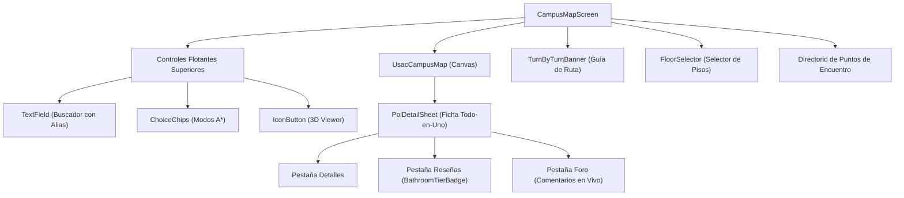

# 01 — Arquitectura y Componentes del Mapa

> Componentes de interfaz, controlador de estado, integración de temas y modelos del módulo de mapa.

---

## 1. Componentes Principales de Interfaz (Widgets)

El módulo de mapa unifica componentes de la librería [`usac_campus_map`](file:///C:/Users/HP/Documents/Programacion/Flutter/usac_campus_map) (versión `0.5.0`) con la arquitectura y sistema de diseño Material 3 de la aplicación del estudiante.



### 1.1 `UsacCampusMap` (Lienzo Cartográfico)
Componente de renderizado de capas vectoriales construido sobre `flutter_map`:
- **Polígonos de Edificios**: Huellas edilicias con colores diferenciados según categoría académica o de servicio, bordes definidos y etiquetas de texto en alta resolución.
- **Rutas y Andadores**: Capas de polilíneas dinámicas coloreadas según el modo de navegación activo (azul para peatonal, verde para techada, naranja para escalinatas).
- **Interacción Táctil**: Detecta toques en el mapa mediante algoritmos geométricos (`isPointInPolygon` y cálculo Haversine de proximidad), abriendo automáticamente la ficha de detalle [`PoiDetailSheet`](file:///C:/Users/HP/Documents/Programacion/Flutter/usac_campus_map/lib/src/presentation/widgets/poi_detail_sheet.dart).

### 1.2 `PoiDetailSheet` (Ficha Inferior Todo-en-Uno)
Ficha modal interactiva estructurada en 3 pestañas:
1. **Pestaña Detalles**: Identificador, nombre formal, alias reconocidos, niveles construidos, accesos peatonales mapeados, botón para iniciar navegación y botón para abrir el modelo 3D.
2. **Pestaña Reseñas**: Badge de clasificación semántica, promedio de puntuación, desglose de etiquetas observadas (agua, papel, jabón, WiFi, tomas) y botón modal para calificar.
3. **Pestaña Foro**: Hilo de discusión en vivo del lugar específico, con soporte para respuestas anidadas y actualización reactiva.

### 1.3 `TurnByTurnBanner` (Banner Direccional)
Se despliega en la parte superior cuando existe una ruta activa:
- Muestra la distancia restante en metros (`m`) o kilómetros (`km`).
- Tiempo estimado de caminata en minutos (`min`).
- Instrucción del paso actual (ej. *"Camine hacia el norte por el andador principal"*).
- Icono direccional adaptado (giro a la izquierda, derecha, escaleras o llegada).
- Botón para cancelar la navegación activa (`_controller.clearRoute()`).

### 1.4 `FloorSelector` (Selector de Niveles Interiores)
Aparece como un control flotante vertical cuando se selecciona un edificio con más de un nivel (`floorsCount > 1`):
- Permite alternar entre los pisos (ej. 1, 2, 3, 4).
- Al cambiar de piso, filtra automáticamente los POIs y sanitarios que pertenecen al nivel seleccionado.

### 1.5 `Building3DViewer` (Visor Volumétrico 3D)
Widget volumétrico isométrico interactivo:
- Proyecta en tiempo real la huella 2D del edificio a un cuerpo 3D según su número de niveles (`floorsCount * 3.5m`).
- Soporta gestos táctiles de arrastre para rotación y pellizco (*pinch-to-zoom*) para escalar el modelo.

### 1.6 `BathroomTierBadge` (Distintivo de Sanitarios)
Widget visual especializado ([`bathroom_tier_badge.dart`](file:///C:/Users/HP/Documents/Programacion/Flutter/Comunidad_USAC/comunidad_universitaria/lib/features/map/widgets/bathroom_tier_badge.dart)) para la escala oficial de 5 clases de sanitarios USAC:
- Renderiza el emoji, la denominación oficial (*"Templo de los dioses"*, *"Disfrutable"*, etc.) y el color distintivo.
- En modo expandido, despliega la descripción de salubridad y los chips con el recuento de etiquetas verificadas.

---

## 2. Capa de Estado y Ciclo de Vida: `UsacCampusMapController`

El estado del mapa se gestiona mediante [`UsacCampusMapController`](file:///C:/Users/HP/Documents/Programacion/Flutter/usac_campus_map/lib/src/controllers/usac_campus_map_controller.dart), el cual implementa `ChangeNotifier`:

```dart
late final UsacCampusMapController _controller;
late final SupabaseCampusCommunityRepository _communityRepo;

@override
void initState() {
  super.initState();
  _communityRepo = SupabaseCampusCommunityRepository();
  _controller = UsacCampusMapController(
    communityRepository: _communityRepo,
  );
  _controller.addListener(_onControllerChanged);
  _initMapData();
}

Future<void> _initMapData() async {
  // 1. Carga inicial desde caché R2 o assets empaquetados
  await MapSyncService.loadRepositoryData(_controller.repository);
  await _controller.loadData();
  if (mounted) setState(() {});

  // 2. Sincronización en segundo plano con Cloudflare R2
  MapSyncService.syncMapAssetsIfNeeded();
}
```

### Propiedades y Métodos Clave del Controlador
- `_controller.buildings`: Lista completa de edificios mapeados en el campus central.
- `_controller.selectBuilding(String? id)`: Selecciona un edificio y activa su resaltado perimetral.
- `_controller.search(String query)`: Ejecuta búsqueda difusa en nombres formales y alias.
- `_controller.findRoute(...)`: Traza la ruta óptima mediante el motor A*.
- `_controller.toggle3DMode()`: Alterna la bandera de visualización tridimensional.
- `_controller.clearRoute()`: Restablece el mapa al modo de exploración libre.

---

## 3. Integración con el Sistema de Diseño (`UsacMapTheme`)

El tema visual del mapa se mapea directamente desde los tokens globales definidos en [`AppTheme`](file:///C:/Users/HP/Documents/Programacion/Flutter/Comunidad_USAC/comunidad_universitaria/lib/core/config/app_theme.dart) y [`docs/ux/09-sistema-diseno.md`](file:///C:/Users/HP/Documents/Programacion/Flutter/Comunidad_USAC/docs/ux/09-sistema-diseno.md):

| Propiedad | Modo Claro | Modo Oscuro | Propósito |
|---|---|---|---|
| `primaryColor` | `#004B87` (Azul USAC) | `#0066CC` (Azul Claro) | Cabeceras, banners y botones primarios |
| `accentColor` | `#EAB308` (Oro USAC) | `#EAB308` (Oro USAC) | Resaltado de edificios y elementos activos |
| `buildingDefaultColor` | `#35004B87` | `#55004B87` | Relleno semitransparente de huellas edilicias |
| `buildingBorderColor` | `#004B87` | `#60A5FA` | Contorno perimetral de edificios |
| `routeStandardColor` | `#0284C7` | `#38BDF8` | Trazo de ruta peatonal estándar |
| `routeCoveredColor` | `#16A34A` | `#4ADE80` | Trazo de andador techado (temporada de lluvia) |
| `routeStairsColor` | `#EA580C` | `#FB923C` | Advertencia visual de gradas o desniveles |
| `tileUrlTemplate` | OpenStreetMap Estándar | CartoDB Dark Matter | Teselas base de contexto exterior |
