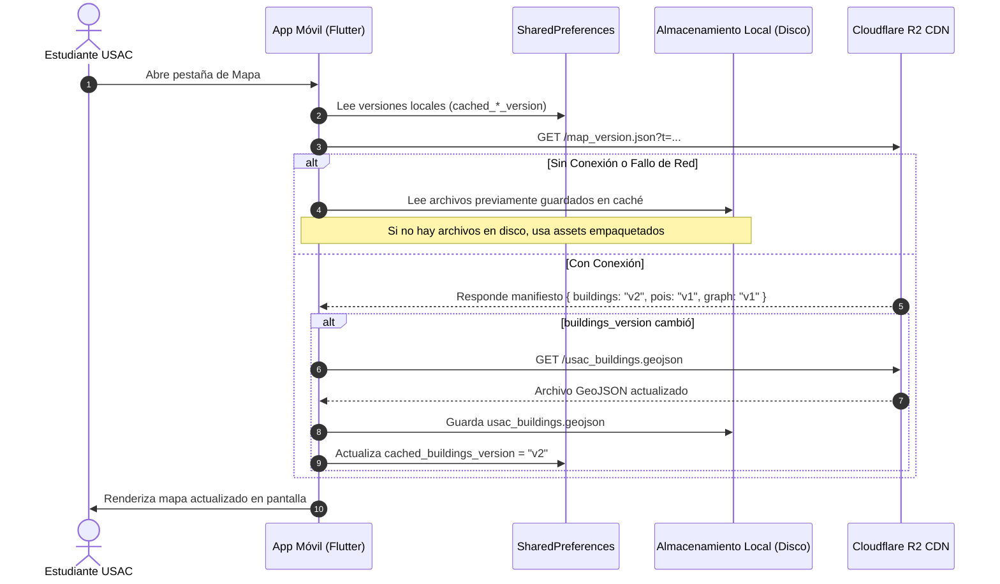

# 02 — Sincronización Inteligente con Cloudflare R2 y Modo Offline

> Estrategia de ahorro de datos móviles (Zero Redundant Downloads), manifiesto de versiones y fallback local.

---

## 1. Estrategia de Ahorro de Datos (Zero Redundant Downloads)

Los estudiantes sancarlistas suelen conectarse a la aplicación desde conexiones móviles (3G/4G/LTE) dentro de la Ciudad Universitaria. Para evitar descargas repetitivas de archivos cartográficos de varios megabytes:

1. **Consulta ultraligera**: Al inicializar la pantalla de mapa, la app únicamente consulta `map_version.json` (~150 bytes) utilizando un *cache-buster* temporal (`?t=timestamp`).
2. **Comparación local**: Se cotejan las claves `buildings_version`, `pois_version` y `graph_version` contra las registradas en `SharedPreferences` del dispositivo.
3. **Descarga selectiva**: Se descarga **únicamente** aquel archivo cuya versión haya cambiado en el CDN R2.
4. **Cero latencia**: Si ninguna versión cambió, los datos se leen directamente del almacenamiento local o de los assets empaquetados en 0 milisegundos y con cero consumo de datos móviles.



---

## 2. Manifiesto Remoto (`map_version.json`)

El archivo alojado en el bucket de Cloudflare R2 (`usac-map-assets`) sigue la siguiente estructura:

```json
{
  "buildings_version": "2026.11.09",
  "pois_version": "2026.11.09",
  "graph_version": "2026.11.09",
  "min_app_version": "0.5.0",
  "notes": "Actualización de andadores accesibles y sanitarios del edificio T-3"
}
```

---

## 3. Implementación del Servicio: `MapSyncService`

El servicio [`MapSyncService`](file:///C:/Users/HP/Documents/Programacion/Flutter/Comunidad_USAC/comunidad_universitaria/lib/features/map/services/map_sync_service.dart) orquesta la verificación y el almacenamiento en disco:

```dart
class MapSyncService {
  static String r2BaseUrl =
      const String.fromEnvironment('R2_MAP_BASE_URL', defaultValue: 'https://usac-map-assets.r2.dev');

  static const String keyBuildingsVer = 'cached_buildings_version';
  static const String keyPoisVer = 'cached_pois_version';
  static const String keyGraphVer = 'cached_graph_version';

  /// Sincroniza selectivamente los activos cartográficos desde Cloudflare R2 si cambiaron de versión
  static Future<bool> syncMapAssetsIfNeeded({
    http.Client? httpClient,
    SharedPreferences? preferences,
  }) async { ... }
}
```

### 3.1 Carga Híbrida de Datos (`loadRepositoryData`)
Para alimentar el motor cartográfico, `loadRepositoryData` evalúa en orden de precedencia:
1. **Archivos descargados en disco** (`getApplicationDocumentsDirectory()`): Si existen `usac_buildings.geojson`, `usac_pois_and_indoors.json` y `campus_graph.json`, se parsean y se inyectan mediante `repository.loadFromJson(...)`.
2. **Assets empaquetados en la aplicación**: Si el usuario abre la aplicación por primera vez sin internet, se realiza fallback automático a los assets locales (`packages/usac_campus_map/assets/...`).
3. **Compatibilidad Web**: En navegadores web donde `dart:io` `File` no está disponible, la app consume automáticamente los assets empaquetados garantizando estabilidad total.

---

## 4. Archivos Cartográficos Sincronizados

| Archivo | Tipo | Contenido y Uso |
|---|---|---|
| `usac_boundary.geojson` | GeoJSON | Polígono perimetral del Campus Central de la USAC (Zona 12). |
| `usac_buildings.geojson` | GeoJSON | Huellas edilicias de facultades, escuelas no facultativas, rectoría y plazas. |
| `usac_pois_and_indoors.json` | JSON | Puntos de interés, sanitarios, cafeterías y niveles interiores. |
| `campus_places_info.json` | JSON | Metadatos extendidos de horarios, accesos y facultades alojadas. |
| `campus_graph.json` | JSON | Grafo topológico peatonal con nodos y aristas ponderadas para el algoritmo A*. |
