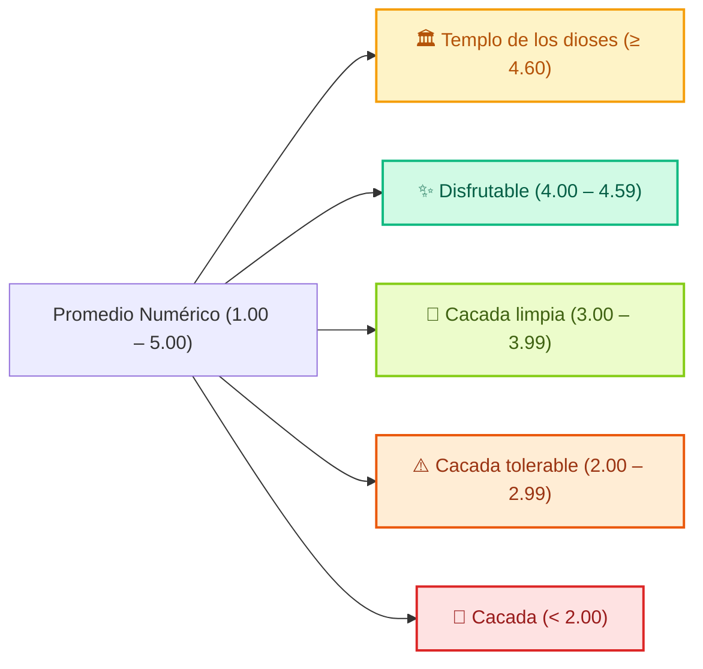

# 03 — Módulo de Calificaciones y Sanitarios (Escala Oficial de 5 Clases)

> Clasificación semántica de sanitarios, tags de verificación higiénica, agregados precomputados y RPC segura con seudónimo.

---

## 1. La Escala Oficial de 5 Clases de Sanitarios USAC

En los sanitarios universitarios, una calificación genérica de estrellas no comunica la realidad operativa del servicio. Por esta razón, la aplicación implementa la **Escala Semántica Oficial de Sanitarios USAC**, asignando categorías descriptivas basadas en el promedio de las opiniones estudiantiles:



### 1.1 Definición de Clases (`BathroomTierConfig`)

| Clase | Código | Emoji | Rango | Color Hex | Descripción Semántica Oficial |
|---|---|:---:|:---:|:---:|---|
| **Templo de los dioses** | `templo_dioses` | 🏛️ | $\ge 4.60$ | `#F59E0B` | Impecable, papel garantizado, agua constante y aromatizado. |
| **Disfrutable** | `disfrutable` | ✨ | $4.00 - 4.59$ | `#10B981` | Muy limpio, agua corriente, jabón y pestillo seguro. |
| **Cacada limpia** | `cacada_limpia` | 🧼 | $3.00 - 3.99$ | `#84CC16` | Aceptable: inodoros higiénicos y agua disponible. |
| **Cacada tolerable** | `cacada_tolerable` | ⚠️ | $2.00 - 2.99$ | `#EA580C` | Solo emergencias: falta papel higiénico o jabón. |
| **Cacada** | `cacada` | 💩 | $< 2.00$ | `#DC2626` | Sin agua ni insumos, higiene deficiente. Evitar a toda costa. |

### 1.2 Etiquetas de Verificación Higiénica
Al calificar un baño, el alumno puede marcar las condiciones observadas:
- `has_water`: `💧 Agua corriente`
- `has_paper`: `🧻 Papel higiénico`
- `has_soap`: `🧼 Jabón de manos`
- `door_locks`: `🔒 Pestillo seguro`
- `is_clean`: `✨ Limpio`

---

## 2. Consulta Eficiente de Agregados (`campus_rating_aggregates`)

Para evitar recalcular promedios en vivo con cada apertura de la ficha, la aplicación consulta la tabla de agregados precomputados de Supabase mediante [`CampusCommunitySupabaseService.fetchTargetAggregate`](file:///C:/Users/HP/Documents/Programacion/Flutter/Comunidad_USAC/comunidad_universitaria/lib/features/map/services/campus_community_supabase_service.dart):

```dart
final aggregate = await supabase
    .from('campus_rating_aggregates')
    .select('average_rating, total_reviews, bathroom_class, tags_summary')
    .eq('target_id', targetId)
    .maybeSingle();
```

El objeto retornado contiene:
- `average_rating`: Promedio numérico en punto flotante (ej. `4.72`).
- `total_reviews`: Número total de estudiantes que han calificado el lugar.
- `bathroom_class`: Clase asignada si el lugar es sanitario (ej. `templo_dioses`).
- `tags_summary`: Mapa JSONB con el recuento de etiquetas (ej. `{"has_water": 18, "has_soap": 15}`).

