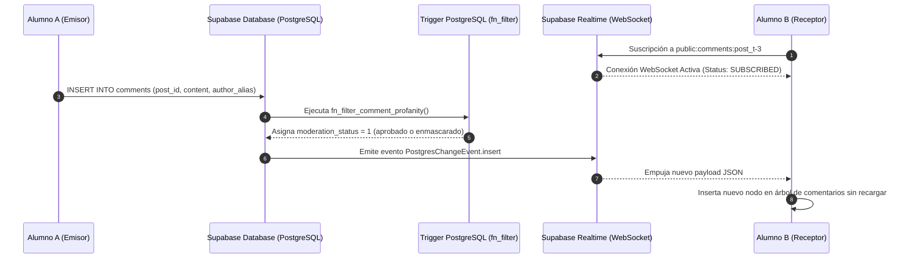

# 04 — Foro Comunitario en Vivo y Tiempo Real

> Suscripción WebSocket a Supabase Realtime, moderación antipalabrotas preventiva, respuestas anidadas y soporte para marcadores tombstone.

---

## 1. Arquitectura de Conexión en Tiempo Real

Cada edificio o lugar cuenta con un hilo de discusión comunitario. Para que los estudiantes reciban respuestas instantáneas sin necesidad de recargar la pantalla, se implementa [`ForumCommentsController`](file:///C:/Users/HP/Documents/Programacion/Flutter/Comunidad_USAC/comunidad_universitaria/lib/features/map/services/campus_community_supabase_service.dart), el cual establece un canal WebSocket dedicado con Supabase Realtime:



---

## 2. Controlador de Eventos: `ForumCommentsController`

```dart
class ForumCommentsController {
  final String postId;
  final SupabaseClient? _client;
  RealtimeChannel? _commentsChannel;

  void subscribeToComments({
    required void Function(Map<String, dynamic> newComment) onCommentInserted,
    required void Function(Map<String, dynamic> updatedComment) onCommentUpdated,
    required void Function(String deletedCommentId) onCommentDeleted,
  }) {
    final client = supabase;
    if (client == null) return;

    final channelName = 'public:comments:post_$postId';
    _commentsChannel = client.channel(channelName)
      ..onPostgresChanges(
        event: PostgresChangeEvent.insert,
        schema: 'public',
        table: 'comments',
        filter: PostgresChangeFilter(
          type: PostgresChangeFilterType.eq,
          column: 'post_id',
          value: postId,
        ),
        callback: (payload) {
          final row = payload.newRecord;
          // Mostrar solo si está aprobado o si fue escrito por el usuario actual
          if (row['moderation_status'] == 1 ||
              row['user_id'] == client.auth.currentUser?.id) {
            onCommentInserted(row);
          }
        },
      )
      ..onPostgresChanges(
        event: PostgresChangeEvent.update,
        schema: 'public',
        table: 'comments',
        filter: PostgresChangeFilter(
          type: PostgresChangeFilterType.eq,
          column: 'post_id',
          value: postId,
        ),
        callback: (payload) => onCommentUpdated(payload.newRecord),
      )
      ..onPostgresChanges(
        event: PostgresChangeEvent.delete,
        schema: 'public',
        table: 'comments',
        filter: PostgresChangeFilter(
          type: PostgresChangeFilterType.eq,
          column: 'post_id',
          value: postId,
        ),
        callback: (payload) {
          final oldRecord = payload.oldRecord;
          if (oldRecord['id'] != null) {
            onCommentDeleted(oldRecord['id'].toString());
          }
        },
      )
      ..subscribe();
  }

  void dispose() {
    _commentsChannel?.unsubscribe();
  }
}
```

---

## 3. Moderación Automática y Filtro Antipalabrotas

Al insertar un comentario en `public.comments`:
1. El trigger PostgreSQL `fn_filter_comment_profanity()` analiza el contenido antes de confirmar la transacción.
2. **Nivel 1 (Modismos leves)**: Enmascara automáticamente los términos con asteriscos (ej. `c****e`) y aprueba la publicación inmediata con `moderation_status = 1`.
3. **Nivel 2/3 (Agresiones graves)**: Cambia el estado a `moderation_status = 2` (Oculto preventivo) y genera una alerta en la bitácora administrativa para revisión manual en el panel de moderación.

---

## 4. Respuestas Anidadas y Marcador *Tombstone*

Los comentarios soportan hilos subordinados mediante la columna auto-referenciada `parent_id`:
- **Preservación del hilo**: Si un administrador o moderador elimina un comentario principal que ya posee respuestas, no se aplica borrado en cascada que destruiría la discusión.
- **Marcador Tombstone**: En su lugar, el comentario eliminado se marca como `is_deleted = true` y se renderiza con estilo atenuado:
  > *"Este comentario ha sido retirado por infringir las normas de convivencia comunitaria."*
- Los comentarios hijos subordinados permanecen visibles y legibles en el árbol jerárquico.
