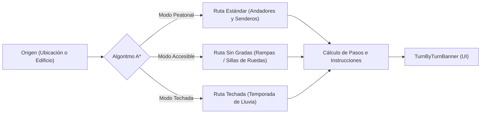

# 05 — Navegación A* Multi-modal, Búsqueda Difusa y Adaptabilidad UI

> Algoritmo A* multi-modal, catálogo de alias sancarlistas, responsive layout (Desktop Split vs Mobile Sheet) y tokens de diseño.

---

## 1. Búsqueda Difusa y Alias Tradicionales Sancarlistas

Los estudiantes suelen referirse a los edificios del Campus Central por sus nombres populares o códigos abreviados en lugar del nombre formal del registro catastral. El motor [`SearchEngine`](file:///C:/Users/HP/Documents/Programacion/Flutter/usac_campus_map/lib/src/engine/search_engine.dart) integra un diccionario de alias fonéticos y ponderados:

| Alias Popular Ingresado | Coincidencia en Grafo | Edificio o Espacio Resuelto |
|---|---|---|
| `"El Iglú"` o `"Iglú"` | `iglu` | Plaza de los Mártires / Auditorio Iglú |
| `"T-3"` o `"T3"` | `t-3` | Edificio T-3 (Facultad de Ingeniería) |
| `"S-12"` o `"Efpem"` | `s-12` | Edificio S-12 (EFPEM / Humanidades) |
| `"El Huerto"` | `huerto` | El Huerto (Agronomía / Veterinaria) |
| `"Los Cubos"` | `cubos` | Los Cubos (Plaza de Agronomía) |
| `"Rectoría"` o `"CSU"` | `rectoria` | Edificio de Rectoría / Consejo Superior |
| `"RyE"` | `registro` | Registro y Estadística |
| `"5B"` | `s-5` | Aula Magna / Edificio S-5 |

La búsqueda se ejecuta en menos de 10 milisegundos en memoria mediante `_controller.search(query)`, ordenando los resultados por relevancia y destacando visualmente la coincidencia de alias (`matchedAlias`).

---

## 2. Ruteo Multi-Modal sobre Grafo Topológico (Algoritmo A\*)

El motor de cálculo de rutas ejecuta el algoritmo **A\*** con heurística euclidiana sobre el grafo peonil de andadores y plazas universitarias (`campus_graph.json`):

### 2.1 Perfiles de Navegación (`NavigationMode`)

1. **`NavigationMode.pedestrian` (Peatonal Estándar)**:
   - Utiliza la distancia geométrica real como peso de arista.
   - Selecciona la ruta de caminata más corta y directa.
2. **`NavigationMode.accessible` (Sin Gradas / Accesible)**:
   - Penaliza con factor infinito ($\infty$) las aristas catalogadas como escalinatas (`stairs`).
   - Prioriza andadores llanos y rampas para estudiantes con movilidad reducida o usuarios en silla de ruedas.
3. **`NavigationMode.covered` (Ruta Techada / Temporada de Lluvia)**:
   - Reduce artificialmente el peso de las aristas con techo o pasillos techados entre edificios contiguos.
   - Guía al estudiante protegiéndolo de las fuertes lluvias del invierno guatemalteco.

---

## 3. Adaptabilidad Responsiva y Experiencia de Usuario (UI/UX)

La pantalla [`CampusMapScreen`](file:///C:/Users/HP/Documents/Programacion/Flutter/Comunidad_USAC/comunidad_universitaria/lib/features/map/screens/campus_map_screen.dart) se adapta dinámicamente al tamaño del dispositivo según los breakpoints de [`docs/ux/09-sistema-diseno.md`](file:///C:/Users/HP/Documents/Programacion/Flutter/Comunidad_USAC/docs/ux/09-sistema-diseno.md):

### 3.1 Vista de Escritorio y Tablets Horizontales ($\ge 700\text{px}$)
- **Disposición Dividida (Split View)**:
  - **Lado Izquierdo (Flex 6)**: Lienzo cartográfico interactivo a pantalla completa con buscador flotante, chips de modo A*, selector vertical de pisos y banner superior de navegación.
  - **Lado Derecho (Ancho Fijo 380px)**: Panel de directorio estructurado con buscador, chips de campus (*Todas*, *Campus Central*, *CUM*) y listado de edificios con botón *"Cómo llegar"*.

### 3.2 Vista Móvil ($< 700\text{px}$)
- **Capa Base**: Lienzo cartográfico completo con gestos multitáctiles.
- **Hoja Inferior Arrastrable (`DraggableScrollableSheet`)**:
  - `initialChildSize: 0.55`: Ocupa el 55% inferior de la pantalla al inicio, dejando el 45% superior para visualizar el mapa y los controles.
  - `minChildSize: 0.15`: Se colapsa a una barra delgada para permitir exploración total del lienzo.
  - `maxChildSize: 0.95`: Se expande casi a pantalla completa para explorar el directorio como catálogo tradicional.
  - Contiene los puntos de encuentro y edificios de la USAC, garantizando compatibilidad total con las pruebas de navegación de [`test/widgets/app_shell_test.dart`](file:///C:/Users/HP/Documents/Programacion/Flutter/Comunidad_USAC/comunidad_universitaria/test/widgets/app_shell_test.dart).

---

## 4. Garantía de Calidad y Pruebas Automatizadas

El módulo cuenta con una suite integral de pruebas en [`test/features/map/`](file:///C:/Users/HP/Documents/Programacion/Flutter/Comunidad_USAC/comunidad_universitaria/test/features/map/):
- **`bathroom_tier_test.dart`**: Verificación de umbrales matemáticos (4.60, 4.00, 3.00, 2.00), denominaciones semánticas, colores y renderizado de `BathroomTierBadge`.
- **`map_sync_service_test.dart`**: Prueba de sincronización selectiva con mocks HTTP, persistencia en directorio local y fallback ante fallos de conexión.
- **`campus_community_supabase_service_test.dart`**: Pruebas del repositorio híbrido, registro de esquemas por categoría, actualización optimista y anidación de comentarios.
- **`campus_map_screen_test.dart`**: Renderizado adaptativo en móvil (400x800) y escritorio (1200x800), búsqueda difusa, chips de filtrado y activación de navegación.
