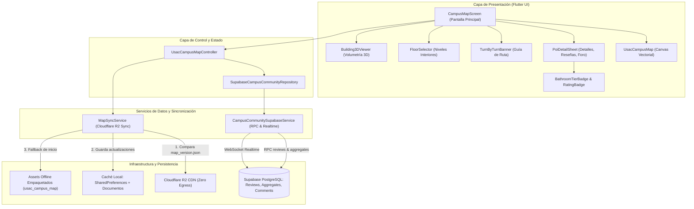

# Módulo de Mapa Cartográfico Interactivo del Campus USAC

**Módulo:** Mapa del Campus, Ruteo A*, Sanitarios y Foro en Tiempo Real  
**Librería Cartográfica:** `usac_campus_map` (v0.5.0)  
**Backend:** Cloudflare R2 (`usac-map-assets`) + Supabase PostgreSQL (Auth, RLS, RPC, Realtime)  
**Ubicación en el Proyecto:** `comunidad_universitaria/lib/features/map/`  
**Estado:** Implementado, auditado con `flutter analyze` (0 errores) y 100% verificado en tests (273/273 tests passing).

---

## 1. Visión General y Propósito

El módulo de Mapa ofrece a la comunidad estudiantil de la Universidad de San Carlos de Guatemala (USAC) una experiencia cartográfica integral, de **cero costo operativo ($0 USD)** y **funcionamiento 100% offline**, con sincronización selectiva opcional desde Cloudflare R2 y servicios comunitarios alojados en Supabase.

### Características Principales
1. **Motor Cartográfico Vectorial Autónomo**: Renderizado con `flutter_map` y `latlong2`, huellas edilicias del Campus Central, grafos de andadores peatonales y puntos de interés (POIs).
2. **Sincronización Inteligente Zero-Egress (Cloudflare R2)**: `MapSyncService` comprueba las versiones de edificios, grafos y POIs mediante un manifiesto ultraligero (`map_version.json` de ~150 B) y descarga únicamente los datos actualizados.
3. **Escala Oficial de 5 Clases para Sanitarios USAC**: Clasificación semántica contextual (*Templo de los dioses*, *Disfrutable*, *Cacada limpia*, *Cacada tolerable* y *Cacada*) sustituyendo las estrellas tradicionales por indicadores reales del estado higiénico.
4. **Reseñas y Calificaciones Protegidas por Seudónimo**: Consulta mediante la RPC PostgreSQL `get_target_reviews_with_authors` para salvaguardar el carné y nombre real de los estudiantes.
5. **Foro Comunitario en Vivo**: Discusión en tiempo real por edificio con suscripción a WebSockets de Supabase Realtime, soporte para respuestas anidadas, filtro antipalabrotas preventivo y marcadores *tombstone*.
6. **Ruteo Multi-modal A\***: Cálculo de trayectorias peatonales óptimas con perfiles específicos: *Peatonal Estándar*, *Sin Gradas (Accesible)* y *Techada (Temporada de Lluvia)*.
7. **Visor Volumétrico 3D**: Inspección volumétrica tridimensional e isométrica de los edificios universitarios (`Building3DViewer`).
8. **UI/UX Adaptativa**: Conforme a los requisitos de `/docs/ux`, respetando los tokens de color (`AppTheme.usacBlue`, `AppTheme.usacGold`), modo claro/oscuro y diseño responsivo (vista dividida en escritorio, panel inferior arrastrable en móvil).
9. **Detección Reactiva de Red (`connectivity_plus`)**: Monitoreo continuo mediante `ConnectivityService`, supresión de llamadas HTTP hacia R2/Supabase si no hay conexión y visualización del `OfflineBanner` canónico según la especificación `UX-X-006`.

---

## 2. Diagrama de Arquitectura Global



---

## 3. Índice de la Documentación

| Documento | Descripción Detallada |
|---|---|
| [`01-arquitectura-y-componentes.md`](01-arquitectura-y-componentes.md) | Catálogo de componentes UI, ciclo de vida del controlador, temas visuales y modelos de datos. |
| [`02-sincronizacion-r2-y-offline.md`](02-sincronizacion-r2-y-offline.md) | Mecanismo de descarga sin redundancia, verificación de versión, caché local y fallback offline. |
| [`03-calificaciones-y-sanitarios.md`](03-calificaciones-y-sanitarios.md) | Escala semántica de 5 clases de sanitarios, tablas de agregados, RPCs de seudónimo y publicación. |
| [`04-foro-en-tiempo-real.md`](04-foro-en-tiempo-real.md) | Arquitectura WebSocket con Supabase Realtime, árbol de respuestas, moderación preventiva y *tombstones*. |
| [`05-navegacion-y-busqueda.md`](05-navegacion-y-busqueda.md) | Motor de búsqueda difusa con alias sancarlistas, algoritmo A* multi-modal y adaptabilidad móvil/escritorio. |
| [`06-conectividad-y-modo-offline.md`](06-conectividad-y-modo-offline.md) | Monitoreo con `connectivity_plus`, arquitectura de `ConnectivityService`, supresión HTTP y `OfflineBanner` (UX-X-006). |

---

## 4. Estructura de Archivos del Módulo

```text
comunidad_universitaria/
├── lib/
│   ├── core/
│   │   └── services/
│   │       └── connectivity_service.dart            # Detección reactiva de interfaces y streams
│   └── features/
│       ├── shared/
│       │   └── widgets/
│       │       └── network_state_widgets.dart       # OfflineBanner estándar (UX-X-006)
│       └── map/
│           ├── models/
│           │   └── bathroom_tier_config.dart        # Escala semántica y umbrales oficiales
│           ├── services/
│           │   ├── map_sync_service.dart            # Sincronización R2 inteligente y comprobación offline
│           │   ├── campus_community_supabase_service.dart # Interacción con PostgreSQL & Realtime
│           │   └── supabase_campus_community_repository.dart # Repositorio híbrido (offline + cloud)
│           ├── widgets/
│           │   └── bathroom_tier_badge.dart         # Distintivo visual de 5 clases y tags
│           └── screens/
│               └── campus_map_screen.dart           # Pantalla completa adaptativa M3 con OfflineBanner
└── test/
    ├── core/
    │   └── services/
    │       └── connectivity_service_test.dart       # Pruebas de interfaces y streams de red
    └── features/
        └── map/
            ├── bathroom_tier_test.dart              # Pruebas de umbrales y badge
            ├── map_sync_service_test.dart           # Pruebas de sincronización y supresión offline
            ├── campus_community_supabase_service_test.dart # Pruebas del repositorio y caché
            └── campus_map_screen_test.dart          # Pruebas de widgets, split layout y OfflineBanner
```
