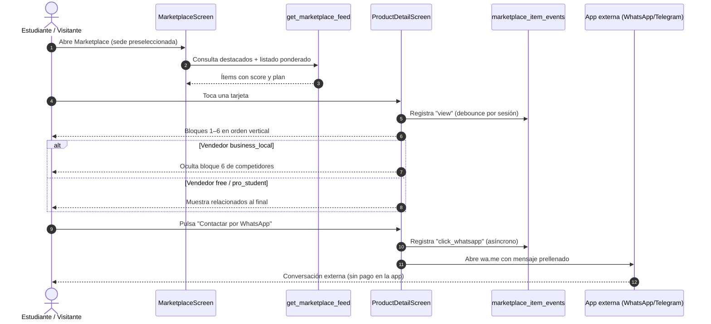
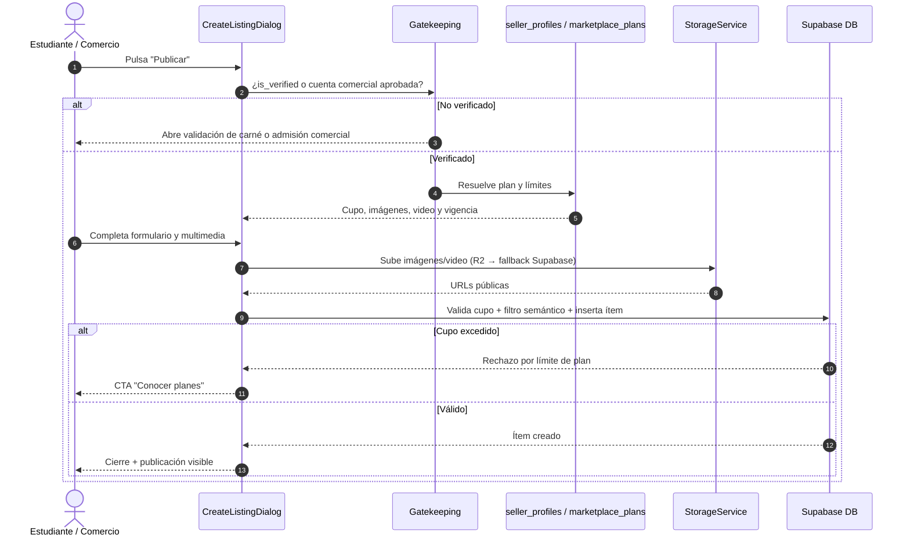
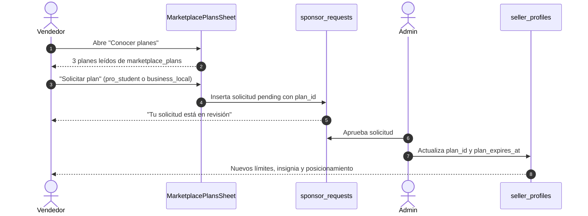
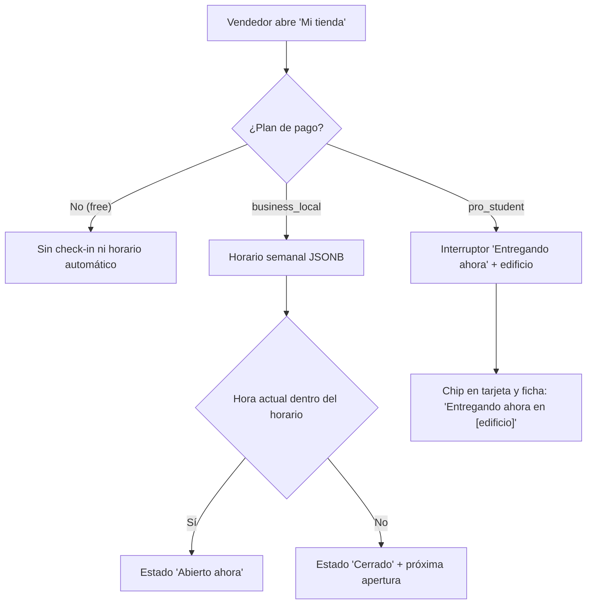
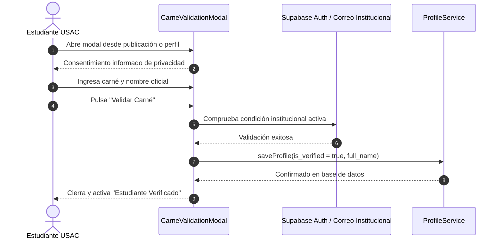

# 04 — Marketplace y tutorías

> Requisitos de experiencia de usuario para el catálogo comercial estudiantil,
> tutorías entre pares, perfiles de tienda, planes de suscripción, descubrimiento
> hiperlocal y medición de conversión. Convenciones, roles y plantilla en
> [`README.md`](README.md).
>
> Los patrocinios se rigen por el modelo transversal
> [`12-patrocinios.md`](12-patrocinios.md) (`UX-SPN`). La visibilidad pagada del
> Marketplace se gobierna por los planes definidos en este documento
> (`UX-MKT-017`, `UX-MKT-018`) y se refleja en el etiquetado de patrocinios
> (`UX-SPN-003`) y en las publicaciones promovidas del Foro (`UX-FORO-021`…) y
> Grupos (`UX-GRP-010`…).

---

## 1. Propósito, visión y modelo de negocio

El **Marketplace & Tutorías** de Comunidad USAC es una plataforma de
**descubrimiento hiperlocal y generación de prospectos (leads)** dentro del
campus ([`01-producto.md`](01-producto.md)). Estudiantes y comercios locales
ofertan productos y servicios a la comunidad; el cierre económico y la entrega
ocurren **fuera de la aplicación**.

### 1.1 Pilares de experiencia del Marketplace
1. **Descubrimiento hiperlocal:** cada publicación se vincula con sede, facultad,
   edificio (`building_code`) y un punto de entrega concreto, de modo que el
   comprador encuentre lo que necesita **cerca de donde está**.
2. **Solidaridad académica:** categoría dedicada a tutorías y asesorías, con
   distintivo especial para aportes y materiales **GRATUITOS**.
3. **Confianza verificada:** publicar exige identidad verificada (carné
   universitario o cuenta comercial aprobada); leer y contactar es abierto.
4. **Trato directo sin intermediación financiera:** la app no procesa pagos,
   retenciones ni cobros; solo facilita el contacto por canales externos.
5. **Monetización por visibilidad (SaaS / freemium):** planes escalonados que
   otorgan alcance algorítmico, capacidad de catálogo, presencia en campus y
   analíticas de conversión, sin cobrar comisión por venta.
6. **Resiliencia y autocuidado:** multimedia tolerante a redes intermitentes y
   filtros comunitarios contra fraude académico y comercio ilícito.

### 1.2 Reglas de negocio inmutables

| ID | Regla | Implicación de experiencia |
|---|---|---|
| `RN-MKT-01` | **Exclusión de intermediación financiera.** La app no procesa pagos, retenciones ni cobros por compras entre usuarios. | Ningún flujo muestra "pagar", "carrito" ni "comisión". Toda coordinación y pago ocurre en WhatsApp, Telegram, Instagram o Messenger. |
| `RN-MKT-02` | **Verificación de identidad obligatoria para publicar.** Ningún usuario anónimo o no verificado crea publicaciones. | El botón "Publicar" evalúa `profiles.is_verified = true` o un perfil comercial aprobado antes de abrir el formulario. |
| `RN-MKT-03` | **Acceso de lectura abierto.** Catálogo, búsqueda, ficha y contacto están disponibles para todos, sin verificación previa. | El visitante puede explorar y abrir canales externos; solo las acciones de escritura (publicar, votar, guardar) piden sesión. |
| `RN-MKT-04` | **Monetización por visibilidad.** Los ingresos provienen de planes de suscripción, no de comisiones por venta. | Los límites, insignias y posicionamiento se leen de `marketplace_plans`; nunca se codifican en el cliente. |
| `RN-MKT-05` | **Moderación sin reescritura de autoría.** La moderación puede ocultar o pausar, nunca alterar autor, precio o contenido. | `moderation_status` cambia; el contenido original se conserva para revisión. |
| `RN-MKT-06` | **Contacto externo primero.** No hay mensajería interna ni custodia de la conversación. | Los botones abren apps externas con mensaje prellenado y registran el clic antes de salir. |
| `RN-MKT-07` | **Telemetría agregada y no identificable.** Se mide la conversión sin exponer a quién se mostró un anuncio. | `marketplace_item_events` guarda `viewer_id` opcional; el vendedor solo ve conteos agregados. |

### 1.3 Planes de suscripción

Los planes viven en `public.marketplace_plans`. Sus precios y límites son
**configurables por administración** y la interfaz los lee de la base de datos;
no se hardcodean en Flutter.

| Atributo / límite | Estudiante (`free`) | Emprendedor (`pro_student`) | Comercio (`business_local`) |
|---|---|---|---|
| Perfil de usuario | Ventas ocasionales (libros, insumos, tutorías) | Ventas recurrentes o ambulantes en el campus | Locales fijos: cafeterías, librerías, fotocopiadoras |
| Precio mensual | `Q0` | `marketplace_plans.price_monthly` | `marketplace_plans.price_monthly` |
| Publicaciones activas (`available`/`reserved`) | Máximo **3** simultáneas | Hasta **20** simultáneas | **Ilimitadas** |
| Vigencia de publicación | **14 días**; pausa automática al vencer | Permanente mientras el plan esté activo | Permanente mientras el plan esté activo |
| Multimedia por ítem | Máximo **2** imágenes (`image_urls`) | Hasta **6** imágenes + **1** video (`video_url`) | Galería extendida + **1** video |
| Insignia de confianza | Estudiante Verificado | Emprendedor Verificado (`sponsor_badge_text`) | Tienda / Local Oficial (`sponsor_badge_text`) |
| Posicionamiento (`is_sponsored`) | Orgánico | Prioridad media en feed y recomendados | Fijado en carrusel superior y prioridad alta |
| Ubicación en tiempo real | No disponible | Check-in manual de edificio (`current_building_code`) | Estado "Abierto / Cerrado" automático según horario |
| Protección de escaparate | Muestra productos de otros vendedores al final | Muestra productos de otros vendedores al final | Oculta o colapsa productos de la competencia en su ficha |
| Analíticas de conversión | Solo conteo público de upvotes | Vistas y clics a contacto | Panel completo de vistas, clics por red y rendimiento |

**Reglas de vigencia y degradación**
- El cupo de publicaciones activas cuenta `available` + `reserved`; `sold` y
  `paused` no consumen cupo.
- Al vencer el plan de pago, `seller_profiles.plan_id` vuelve a `free` y se
  aplican sus límites **sin borrar** publicaciones: las excedentes pasan a
  `paused` y el vendedor elige cuáles reactivar.
- Las publicaciones del plan `free` se pausan automáticamente al cumplir 14 días;
  el vendedor puede reactivarlas si su cupo de 3 activas lo permite.
- El cambio de plan nunca modifica el contenido ni la autoría de las
  publicaciones existentes.

### 1.4 Actores del Marketplace

| Actor | Puede leer / contactar | Puede publicar | Presencia en campus | Analíticas |
|---|:--:|:--:|:--:|:--:|
| Visitante | Sí | No (pide sesión y verificación) | No | No |
| Estudiante verificado (`free`) | Sí | Sí, con límites del plan | No | Conteo público de upvotes |
| Emprendedor (`pro_student`) | Sí | Sí, hasta 20 activas | Check-in manual | Vistas y clics |
| Comercio local (`business_local`) | Sí | Sí, ilimitadas | Abierto/cerrado por horario | Panel completo |
| Moderador / Admin | Sí | Según su verificación | No aplica | Panel completo y moderación |

---

## 2. Matriz de requisitos

| Identificador | Título del requisito | Prioridad | Actor principal | Estado / Tipo |
|---|---|---|:---:|---|
| [`UX-MKT-001`](#ux-mkt-001--banner-superior-e-identidad-de-comercio-seguro-estudiantil) | Banner superior e identidad de comercio seguro estudiantil | **Must** | Todos los roles | Objetivo |
| [`UX-MKT-002`](#ux-mkt-002--carrusel-superior-destacado-para-patrocinadores-y-comercios) | Carrusel superior destacado para patrocinadores y comercios | **Should** | Todos / Comercio | Objetivo |
| [`UX-MKT-003`](#ux-mkt-003--solicitud-de-cuenta-comercial-y-espacio-de-patrocinio) | Solicitud de cuenta comercial y espacio de patrocinio | **Should** | Estudiante / Comercio | Objetivo |
| [`UX-MKT-004`](#ux-mkt-004--barra-de-búsqueda-y-filtros-facetados-sede-facultad-edificio-y-categoría) | Barra de búsqueda y filtros facetados (sede, facultad, edificio y categoría) | **Must** | Todos los roles | Objetivo |
| [`UX-MKT-005`](#ux-mkt-005--cuadrícula-responsiva-y-tarjetas-de-producto-con-contexto-de-plan) | Cuadrícula responsiva y tarjetas de producto con contexto de plan | **Must** | Todos los roles | Objetivo |
| [`UX-MKT-006`](#ux-mkt-006--galería-multimedia-por-plan-y-visor-modal-con-zoom) | Galería multimedia por plan y visor modal con zoom | **Should** | Todos los roles | Objetivo |
| [`UX-MKT-007`](#ux-mkt-007--visualización-de-precios-en-quetzales-y-distintivo-de-aportes-gratuitos) | Visualización de precios en Quetzales y distintivo de aportes gratuitos | **Must** | Todos los roles | Objetivo |
| [`UX-MKT-008`](#ux-mkt-008--gestión-de-ciclo-de-vida-del-artículo-disponible-reservado-vendido) | Gestión de ciclo de vida del artículo (disponible, reservado, vendido) | **Must** | Vendedor | **[Mejora]** |
| [`UX-MKT-009`](#ux-mkt-009--contacto-directo-multicanal-y-registro-de-intención-de-compra) | Contacto directo multicanal y registro de intención de compra | **Must** | Comprador / Vendedor | Objetivo |
| [`UX-MKT-010`](#ux-mkt-010--votación-comunitaria-de-utilidad-y-reputación-upvote) | Votación comunitaria de utilidad y reputación (Upvote) | **Should** | Estudiante registrado | Objetivo |
| [`UX-MKT-011`](#ux-mkt-011--reporte-comunitario-de-anuncios-irregulares-o-fraudulentos) | Reporte comunitario de anuncios irregulares o fraudulentos | **Must** | Todos los roles | Objetivo |
| [`UX-MKT-012`](#ux-mkt-012--formulario-de-publicación-con-gatekeeping-y-límites-de-plan) | Formulario de publicación con gatekeeping y límites de plan | **Must** | Vendedor verificado | Objetivo |
| [`UX-MKT-013`](#ux-mkt-013--filtro-semántico-preventivo-de-términos-prohibidos-y-fraude-académico) | Filtro semántico preventivo de términos prohibidos y fraude académico | **Must** | Vendedor / Moderador | Objetivo |
| [`UX-MKT-014`](#ux-mkt-014--verificación-para-vender-carné-o-cuenta-comercial-aprobada) | Verificación para vender (carné o cuenta comercial aprobada) | **Must** | Vendedor | **[Mejora]** |
| [`UX-MKT-015`](#ux-mkt-015--almacenamiento-resiliente-de-multimedia-con-fallback-de-infraestructura) | Almacenamiento resiliente de multimedia con fallback de infraestructura | **Should** | Vendedor | **[Mejora]** |
| [`UX-MKT-016`](#ux-mkt-016--perfil-público-de-tienda-y-carta-de-presentación-del-vendedor) | Perfil público de tienda y carta de presentación del vendedor | **Must** | Vendedor | **[Mejora]** |
| [`UX-MKT-017`](#ux-mkt-017--límites-efectivos-y-vigencia-por-plan-de-suscripción) | Límites efectivos y vigencia por plan de suscripción | **Must** | Vendedor | Objetivo |
| [`UX-MKT-018`](#ux-mkt-018--catálogo-de-planes-contratación-y-cambio-de-plan) | Catálogo de planes, contratación y cambio de plan | **Must** | Vendedor / Admin | Objetivo |
| [`UX-MKT-019`](#ux-mkt-019--perfil-comercial-estado-de-tienda-y-presencia-en-el-campus) | Perfil comercial, estado de tienda y presencia en el campus | **Must** | Comercio / Emprendedor | Objetivo |
| [`UX-MKT-020`](#ux-mkt-020--feed-principal-ponderado-y-carrusel-destacado) | Feed principal ponderado y carrusel destacado | **Must** | Todos los roles | Objetivo |
| [`UX-MKT-021`](#ux-mkt-021--ficha-de-detalle-de-producto-con-jerarquía-vertical-estricta) | Ficha de detalle de producto con jerarquía vertical estricta | **Must** | Comprador | Objetivo |
| [`UX-MKT-022`](#ux-mkt-022--catálogo-del-mismo-vendedor-más-productos-de) | Catálogo del mismo vendedor ("Más productos de…") | **Must** | Comprador | Objetivo |
| [`UX-MKT-023`](#ux-mkt-023--productos-relacionados-de-otros-vendedores-y-protección-de-escaparate) | Productos relacionados de otros vendedores y protección de escaparate | **Must** | Comprador / Comercio | Objetivo |
| [`UX-MKT-024`](#ux-mkt-024--telemetría-de-conversión-y-control-de-vistas-por-sesión) | Telemetría de conversión y control de vistas por sesión | **Must** | Vendedor / Plataforma | Objetivo |
| [`UX-MKT-025`](#ux-mkt-025--guardados-de-productos-marcadores) | Guardados de productos (`marketplace_bookmarks`) | **Should** | Comprador | Objetivo |
| [`UX-MKT-026`](#ux-mkt-026--panel-mis-ventas-inventario-presencia-y-analíticas) | Panel "Mis ventas": inventario, presencia y analíticas | **Must** | Vendedor | Objetivo |

---

## 3. Especificación detallada de requisitos

### UX-MKT-001 — Banner superior e identidad de comercio seguro estudiantil
- **Actor / rol:** Visitante, Estudiante, Verificado, Moderador, Admin
- **Prioridad:** Must
- **Estado objetivo:** La pantalla de Marketplace recibe al usuario con un banner
  institucional de alto impacto visual (degradado azul USAC) que comunica la
  naturaleza sin comisiones del servicio, la independencia institucional y el
  trato directo. En desktop incluye un botón primario "Publicar Anuncio" y un
  enlace secundario "Conocer planes"; en móvil la publicación se delega al FAB y
  el enlace a planes vive en el menú de filtros para preservar espacio vertical.
- **Precondiciones:** El usuario accede a la pestaña de Marketplace
  (`/marketplace` o pestaña 1 del cascarón en
  [`app_shell.dart`](../../comunidad_universitaria/lib/features/navigation/app_shell.dart#L180-L194)).
- **UI / contenido:**
  - Contenedor con degradado lineal (`#004B87` a `#1E3A8A`), bordes redondeados
    (16px), padding interior de 20px.
  - Título `titleLarge` (20px, negrita, color `#FFFFFF`): "Marketplace &
    Tutorías Estudiantiles".
  - Subtítulo `bodyMedium` (13px, blanco con opacidad 0.9): "Compra, vende y
    aprende cerca de ti: comidas, libros, tutorías y servicios de la comunidad
    sancarlista. Trato directo, sin comisiones."
  - Botón primario desktop: `ElevatedButton.icon` fondo amarillo oro USAC
    (`#EAB308`), texto negro (`Colors.black87`): "Publicar Anuncio", icono
    `Icons.add_shopping_cart` (18px).
  - Enlace de texto "Conocer planes" (blanco, subrayado) que abre
    `MarketplacePlansSheet` (UX-MKT-018).
- **Interacciones:**
  - "Publicar Anuncio" evalúa sesión y verificación. Con sesión AAL2 y
    vendedor habilitado abre `CreateListingDialog`; si no, abre `AuthModal` o el
    gate de verificación correspondiente (UX-MKT-012 / UX-MKT-014).
  - "Conocer planes" abre el catálogo de planes sin exigir sesión (lectura
    abierta); el botón de contratación sí exige sesión.
- **Estados:**
  - *Inicial / con datos:* banner estático sin latencia.
  - *Carga:* no bloquea el render del encabezado.
  - *Sin conexión:* permanece visible e intacto.
- **Validaciones y reglas de negocio:** La plataforma no es pasarela de pago ni
  custodia fondos [UX-PRD-001]. Recuerda la Regla 5 (trato directo) y la Regla 7
  (seguridad en puntos de encuentro) [ver `08-navegacion-shell-y-reglas.md`].
- **Accesibilidad:** Contraste blanco sobre degradado > 7:1 (AAA); botón > 10:1;
  encabezado semántico `Semantics(header: true)`; área táctil >= 48dp.
- **Responsive:** En móvil (< 700px) se oculta el botón de la fila del banner
  para evitar desbordes. En desktop (>= 1100px) el banner se acota a
  `MaxWidthContainer` (1100px) con las acciones alineadas a la derecha.
- **Criterios de aceptación (Gherkin):**
  - **Given** un estudiante en desktop (>= 1100px), **When** carga Marketplace,
    **Then** ve el banner con el título, el botón "Publicar Anuncio" y el enlace
    "Conocer planes".
  - **Given** un visitante en móvil (< 700px), **When** visualiza el banner,
    **Then** este se adapta verticalmente sin botón de cabecera ni overflow.

---

### UX-MKT-002 — Carrusel superior destacado para patrocinadores y comercios
- **Actor / rol:** Visitante, Estudiante, Comercio, Moderador, Admin
- **Prioridad:** Should
- **Estado objetivo:** La parte superior del catálogo exhibe el carrusel
  "Destacados" con las publicaciones que cumplen `is_sponsored = true`,
  `status = 'available'` y coinciden con la sede del usuario activo. El
  patrocinio proviene del plan (`business_local` o `auto_sponsor_items = true`)
  o de un patrocinio aprobado. Cada tarjeta muestra el nombre comercial, la
  insignia del plan (`sponsor_badge_text`) y acceso a la ficha o a la tienda.
  Sin destacados, el espacio se convierte en una invitación a los planes.
- **Precondiciones:** Consulta a `marketplace_items` con `is_sponsored = true`,
  `status = 'available'`, `moderation_status IS DISTINCT FROM 2` y sede
  coincidente. La sede se toma del perfil activo o del filtro seleccionado.
- **UI / contenido:**
  - *Modo activo:* contenedor con degradado sutil (`#FFFDF5` → `#FEF3C7` claro;
    `#1E293B` → `#0F172A` oscuro), borde dorado de 1.5px (`#F59E0B`) y sombra
    cálida. Chip "Patrocinado" (UX-DSN-008) + insignia del plan ("Tienda / Local
    Oficial" o "Emprendedor Verificado"). Foto 100x100px, nombre comercial
    (`business_name` o `author_alias`), descripción de hasta 3 líneas, chip de
    edificio, chip "Ver video" si `video_url` existe y botón WhatsApp.
  - *Modo vacío:* banner crema con icono `Icons.campaign_outlined`, título
    "Destaca tu negocio en el Marketplace", descripción "Más alcance, catálogo
    ampliado y presencia en el campus con un plan." y botón "Conocer planes".
- **Interacciones:**
  - Tocar la tarjeta abre `ProductDetailScreen` (UX-MKT-021); tocar el nombre
    comercial abre `StoreProfileScreen` (UX-MKT-016).
  - "Conocer planes" abre `MarketplacePlansSheet` (UX-MKT-018).
  - "Contactar por WhatsApp" registra `click_whatsapp` y abre el canal externo
    (UX-MKT-009 / UX-MKT-024).
- **Estados:**
  - *Carga:* skeleton de 120px de alto.
  - *Vacío:* invitación a planes, sin huecos en blanco.
  - *Con datos:* carrusel horizontal con paginación por deslizamiento.
  - *Sin conexión:* última lista destacada en caché con aviso discreto.
- **Validaciones y reglas de negocio:** Solo `moderation_status = 0` puede
  mostrarse; `moderation_status = 1` queda fuera del carrusel público. El
  carrusel no supera 5 unidades y no repite el mismo vendedor en dos tarjetas
  consecutivas. El orden es: plan `business_local`, luego `pro_student`, luego
  patrocinios aprobados; desempate por `upvotes` y `created_at`.
- **Accesibilidad:** Lector de pantalla: "Anuncio patrocinado: [Negocio].
  [Insignia del plan]. Contactar por WhatsApp."; botones >= 48dp.
- **Responsive:** Móvil en columna fluida; desktop horizontal dentro de 1100px,
  mostrando hasta 3 tarjetas sin scroll.
- **Criterios de aceptación (Gherkin):**
  - **Given** una publicación de un comercio `business_local` en la sede del
    usuario, **When** entra a Marketplace, **Then** la ve en el carrusel
    superior con la insignia "Tienda / Local Oficial" y el chip "Patrocinado".
  - **Given** que no hay destacados en la sede activa, **When** se carga la
    pantalla, **Then** el carrusel muestra la invitación "Conocer planes".

---

### UX-MKT-003 — Solicitud de cuenta comercial y espacio de patrocinio
- **Actor / rol:** Estudiante registrado, Emprendedor, Comercio local
- **Prioridad:** Should
- **Estado objetivo:** Un emprendedor o comercio solicita su cuenta comercial y/o
  un plan de visibilidad mediante un formulario guiado. La solicitud se guarda en
  `sponsor_requests` con el plan deseado y queda `pending` hasta la aprobación de
  administración. No hay pagos ni activación automática dentro de la app.
- **Precondiciones:** Sesión iniciada; si es visitante, autenticación previa
  [UX-PRD-010]. No debe existir una solicitud activa (`pending` / `in_review`).
- **UI / contenido:** Diálogo modal adaptativo (`SponsorRequestDialog`):
  - Encabezado con icono estelar (`Icons.star_outline`), título "Solicitar plan
    comercial" y subtítulo "Más alcance y herramientas para vender en el campus".
  - Campo "Nombre del Emprendimiento, Marca o Negocio" (obligatorio, máx. 80).
  - Fila "Nombre del Encargado" (obligatorio) y "WhatsApp" (obligatorio, teclado
    numérico, 8 dígitos GT).
  - "Correo Electrónico de Contacto" (opcional).
  - Selector "Plan deseado": `pro_student` (Emprendedor), `business_local`
    (Comercio) o "Solo patrocinio" (sin plan). El precio se muestra leyendo
    `marketplace_plans`, nunca hardcodeado.
  - Selector "Espacio deseado": "Primera Plana — Marketplace", "Banner en Foro",
    "Presencia integral" (mapea `expected_placement`).
  - Texto "Detalle de la propuesta o productos a promocionar" (obligatorio,
    mínimo 10, máximo 500 caracteres).
  - Nota: "La plataforma no procesa pagos ni cobra comisiones por venta. La
    coordinación del plan se realiza con el equipo por WhatsApp."
  - Botones "Cancelar" y "Enviar Solicitud".
- **Interacciones:** Al enviar, se valida y se inserta en `sponsor_requests`
  (`status = 'pending'`). Se cierra el diálogo con SnackBar "¡Solicitud enviada!
  El equipo se comunicará contigo por WhatsApp.". Si ya hay solicitud activa, el
  botón muestra "Solicitud en revisión" y no abre el formulario (UX-SPN-011).
- **Estados:**
  - *Inicial:* formulario limpio con datos de contacto precargados si existen.
  - *Enviando:* botón deshabilitado con spinner y texto "Enviando…".
  - *Éxito:* cierre + SnackBar.
  - *Error:* mensaje en rojo y datos conservados.
- **Validaciones y reglas de negocio:** No solicita tarjetas ni datos bancarios
  [UX-PRD-001]. Una sola solicitud activa por usuario. El plan solo se activa
  tras aprobación de administración (`UX-MKT-018`).
- **Accesibilidad:** Foco atrapado, cierre con `Escape` en web/desktop y
  `viewInsets.bottom` en móvil; errores anunciados.
- **Responsive:** Móvil `showModalBottomSheet` (esquinas 20px); desktop `Dialog`
  centrado de 560px.
- **Criterios de aceptación (Gherkin):**
  - **Given** un estudiante autenticado sin solicitud previa, **When** completa
    el formulario y envía, **Then** se crea una fila `pending` y ve el mensaje
    de confirmación.
  - **Given** un usuario con solicitud `pending`, **When** intenta abrir el
    formulario, **Then** el sistema muestra el estado y bloquea el duplicado.

---

### UX-MKT-004 — Barra de búsqueda y filtros facetados (sede, facultad, edificio y categoría)
- **Actor / rol:** Visitante, Estudiante, Verificado, Moderador, Admin
- **Prioridad:** Must
- **Estado objetivo:** La exploración del catálogo debe ser rápida, facetada y
  precisa. La cabecera combina búsqueda textual en tiempo real con filtros de
  sede (preseleccionada según el usuario), facultad, edificio (`building_code`),
  categoría y "Solo gratuitos". Los filtros actualizan resultados de forma
  reactiva y no destructiva.
- **Precondiciones:** Pantalla de Marketplace inicializada
  ([`marketplace_screen.dart:45-55`](../../comunidad_universitaria/lib/features/marketplace/screens/marketplace_screen.dart#L45-L55)).
- **UI / contenido:**
  - `TextField` con `Icons.search`, sugerencia "Buscar postres, almuerzos,
    tutorías o libros…" y `Icons.clear` cuando hay texto.
  - Selector de Sede (`USACConstants.sedes`), preseleccionado con la sede del
    perfil; opción "Todas las sedes".
  - Selector de Facultad (`USACConstants.facultades`).
  - Selector de Edificio (`campusBuildings`: T-3, S-12, CUM, etc.), dependiente
    de la sede y la facultad.
  - Chip "Solo gratuitos" (`Icons.volunteer_activism_outlined` → `check_circle`,
    verde `#16A34A`).
  - Fila horizontal de `FilterChip`: "Todas", "Comida & Postres", "Tutorías &
    Asesoría", "Libros & Materiales", "Servicios Estudiantiles", "Otros".
- **Interacciones:**
  - Escribir o presionar Enter ejecuta la búsqueda combinada sobre título,
    descripción y `building_code` (insensible a mayúsculas y tildes).
  - Cambiar sede, facultad o edificio refresca el feed aplicando AND; cambiar de
    sede resetea el edificio si deja de ser válido.
  - "Solo gratuitos" filtra `is_free = true OR price <= 0`.
  - La 'X' limpia el texto y restaura los resultados base.
- **Estados:**
  - *Inicial:* "Todas las sedes/facultades", sin edificio, búsqueda vacía.
  - *Cargando:* skeletons `SkeletonCard`.
  - *Con resultados:* cuadrícula actualizada.
  - *Vacío tras filtro:* `EmptyStateWidget` "No hay publicaciones con estos
    filtros" + acciones "Limpiar filtros" y "Ver todo".
  - *Sin conexión:* filtrado local sobre caché.
- **Validaciones y reglas de negocio:** Lógica AND entre facetas; la sede
  preseleccionada no se impone si el usuario elige "Todas". Los filtros se
  conservan al volver de la ficha de producto (UX-MAP-002).
- **Accesibilidad:** Etiquetas explícitas en selectores y chips; anuncio del
  total de resultados al cambiar un filtro.
- **Responsive:** Móvil: buscador, dos selectores por fila y chips con scroll;
  desktop: una fila con buscador + 3 selectores (<= 180px c/u) + chips.
- **Criterios de aceptación (Gherkin):**
  - **Given** un estudiante que elige "Comida & Postres" y sede "Campus
    Central", **When** se aplican los filtros, **Then** solo ve anuncios que
    cumplen ambos criterios.
  - **Given** un estudiante que selecciona el edificio "T-3", **When** cambia la
    sede a "CUNOC", **Then** el filtro de edificio se limpia y el feed se
    actualiza sin resultados inválidos.

---

### UX-MKT-005 — Cuadrícula responsiva y tarjetas de producto con contexto de plan
- **Actor / rol:** Visitante, Estudiante, Verificado, Moderador, Admin
- **Prioridad:** Must
- **Estado objetivo:** Los productos se exhiben en lista vertical en móvil y
  cuadrícula de 3 columnas en desktop (máx. 1100px). Cada tarjeta sintetiza
  imagen, precio, categoría, ubicación, vendedor, verificación, insignia de plan,
  presencia en campus y accesos rápidos de contacto y guardado.
- **Precondiciones:** Artículos obtenidos de Supabase o caché
  ([`marketplace_screen.dart:58-77`](../../comunidad_universitaria/lib/features/marketplace/screens/marketplace_screen.dart#L58-L77)).
- **UI / contenido:**
  - Tarjeta Material 3, radio 14px, elevación 1dp (2dp con borde dorado si es
    patrocinada).
  - Zona superior de 140px con la imagen principal, chip de categoría
    (izquierda), precio/"GRATIS" (derecha) y `IconButton` de guardado
    (`bookmark_border` / `bookmark`, UX-MKT-025).
  - Título (máx. 2 líneas), descripción (máx. 2 líneas con "…"), ubicación con
    `Icons.place_outlined` (ej. "T-3 · Frente a cafetería") y enlaces externos
    reconocidos.
  - Fila de autor con avatar, `business_name` o `author_alias`, chip de
    verificación, insignia del plan (`Estudiante Verificado`, `Emprendedor
    Verificado`, `Tienda / Local Oficial`) y tiempo relativo.
  - Si `is_currently_on_campus = true` (`pro_student`), chip verde "Entregando
    ahora · [edificio]" con `Icons.location_on`. Para `business_local`, chip
    "Abierto ahora" / "Cerrado" calculado desde `business_hours`, sin mostrar la
    ubicación exacta.
  - Si el video está disponible, icono `Icons.play_circle_fill` sobre la imagen.
  - Pie: upvote con conteo, botones de contacto y menú de opciones (reportar,
    ciclo de vida si es dueño).
- **Interacciones:** Tocar la tarjeta abre la ficha (UX-MKT-021); tocar el
  avatar/nombre abre la tienda (UX-MKT-016); guardar es optimista y exige sesión.
  Pull-to-refresh en toda la pantalla.
- **Estados:**
  - *Carga:* 4 `SkeletonCard` de 220px.
  - *Vacío:* `EmptyStateWidget` con `Icons.storefront_outlined`, "Aún no hay
    publicaciones aquí" y botón "Publicar primero".
  - *Error de red:* `OfflineBanner` con "Reintentar".
- **Validaciones y reglas de negocio:** `moderation_status >= 2` excluido;
  `moderation_status = 1` visible solo para autor y moderadores. Los artículos
  `sold` se muestran con sello y sin contacto. La tarjeta nunca expone datos
  personales no consentidos (UX-PRF-032/033).
- **Accesibilidad:** Grupo semántico por tarjeta (`Semantics(container: true)`);
  acciones secundarias alcanzables por teclado; el chip de presencia se anuncia.
- **Responsive:** Móvil `ListView.builder` (12px de separación); tablet 2
  columnas; desktop 3 columnas (aspecto 0.78, 16px) dentro de 1100px.
- **Criterios de aceptación (Gherkin):**
  - **Given** un usuario en desktop (>= 1100px), **When** carga el catálogo,
    **Then** ve una cuadrícula de 3 columnas uniforme.
  - **Given** un vendedor `business_local` con presencia activa, **When** se
    renderiza su tarjeta, **Then** muestra la insignia del plan y el chip
    "Entregando ahora · [edificio]".
  - **Given** un visitante, **When** pulsa guardar, **Then** se abre el login y,
    al autenticarse, el guardado se aplica (UX-MKT-025).

---

### UX-MKT-006 — Galería multimedia por plan y visor modal con zoom
- **Actor / rol:** Visitante, Estudiante, Verificado, Moderador, Admin
- **Prioridad:** Should
- **Estado objetivo:** La cabecera del producto admite carrusel entre las
  imágenes publicadas según el plan (`free`: 2; `pro_student`: 6 + 1 video;
  `business_local`: galería extendida + 1 video), con contador `1/N`. Si existe
  `video_url`, se muestra un botón de reproducción integrado (sin autoplay con
  sonido). Tocar una imagen abre un visor a pantalla completa con zoom.
- **Precondiciones:** El artículo tiene al menos una URL válida en `imageUrls`
  ([`marketplace_card.dart:96-126`](../../comunidad_universitaria/lib/features/marketplace/widgets/marketplace_card.dart#L96-L126)).
- **UI / contenido:**
  - `PageView.builder` de 140px en tarjeta y de altura flexible en la ficha.
  - Píldora `X/Y` (fondo negro 65%, texto blanco) cuando hay más de una imagen.
  - Botón "Ver video" (`Icons.play_circle_fill`) que abre un reproductor embebido
    o externo, sin reproducción automática con sonido.
  - `ImageViewerDialog`: fondo `Colors.black87`, barra superior con título,
    `Icons.close` e `InteractiveViewer` (0.8x–4.0x).
- **Interacciones:** Deslizar cambia de imagen; doble toque amplía a 2.0x;
  pellizcar/rueda hace zoom; `Escape` o retroceso cierra el visor conservando el
  scroll del catálogo. El video se pausa al salir de la ficha.
- **Estados:**
  - *Cargando:* spinner sutil sobre fondo neutro.
  - *Cargada:* `BoxFit.cover`.
  - *Error:* placeholder con icono de categoría (UX-MKT-015).
  - *Visor activo:* foco modal bloqueante.
- **Validaciones y reglas de negocio:** El máximo de imágenes y la existencia de
  video se validan contra `marketplace_plans` (UX-MKT-017). URLs solo HTTPS.
  Cambiar de imagen no re-renderiza el cuerpo de la tarjeta.
- **Accesibilidad:** "Fotografía 1 de [N] de [Título]"; el video informa duración
  y controles; el visor captura el foco y se cierra con teclado.
- **Responsive:** 140px fijo en tarjetas; en la ficha la galería ocupa el ancho
  disponible con relación 4:3; el visor usa el 100% de la ventana.
- **Criterios de aceptación (Gherkin):**
  - **Given** un artículo `pro_student` con 6 fotos, **When** el usuario desliza,
    **Then** el contador llega a "6/6" y no se ofrecen imágenes extra.
  - **Given** un artículo `free` con 2 fotos, **When** se intenta publicar una
    tercera desde el formulario, **Then** el sistema lo bloquea (UX-MKT-017).
  - **Given** un artículo con `video_url`, **When** se abre la ficha, **Then** el
    video no se reproduce con sonido automáticamente.

---

### UX-MKT-007 — Visualización de precios en Quetzales y distintivo de aportes gratuitos
- **Actor / rol:** Visitante, Estudiante, Verificado, Moderador, Admin
- **Prioridad:** Must
- **Estado objetivo:** Los precios se muestran en Quetzales con prefijo `Q` y dos
  decimales (`QXX.XX`). Si `is_free = true` o `price = 0`, se sustituye por la
  insignia verde `GRATIS`. El precio es **referencial**: la coordinación y el
  pago ocurren fuera de la app.
- **Precondiciones:** El artículo tiene `price` o `is_free`
  ([`marketplace_item.dart:117-122`](../../comunidad_universitaria/lib/core/models/marketplace_item.dart#L117-L122)).
- **UI / contenido:**
  - Badge en la esquina superior derecha (radio 20px, sombra).
  - Precio > 0: fondo azul institucional (`#004B87`) o ámbar (`#D97706`) si es
    patrocinado; texto blanco en negrita ("Q15.00", "Q120.50").
  - Gratuito: fondo verde esmeralda (`#16A34A`), texto "GRATIS".
  - Vendido: fondo gris (`Colors.grey.shade700`), texto "VENDIDO".
- **Interacciones:** Lectura directa; en la ficha se acompaña de la nota "Precio
  referencial. Coordina el pago y la entrega directamente con el vendedor.".
- **Estados:** con precio | gratuito | vendido.
- **Validaciones y reglas de negocio:** Precios >= 0. La plataforma no cobra
  comisiones ni procesa pagos [UX-PRD-001]. `formattedPrice` devuelve "GRATIS"
  para valores `<= 0`.
- **Accesibilidad:** Contraste AA/AAA; lector: "Precio: [N] quetzales" o
  "Publicación gratuita".
- **Responsive:** 12px con padding 10x4, sin solaparse con la categoría.
- **Criterios de aceptación (Gherkin):**
  - **Given** un libro de Q45.00, **When** se renderiza, **Then** el badge dice
    "Q45.00" con fondo azul institucional.
  - **Given** una tutoría con `is_free = true`, **When** se muestra, **Then** el
    badge dice "GRATIS" en verde esmeralda.

---

### UX-MKT-008 — Gestión de ciclo de vida del artículo (disponible, reservado, vendido)
- **Actor / rol:** Vendedor verificado, Comprador
- **Prioridad:** Must
- **Estado objetivo:** El vendedor gestiona el estado de cada artículo con
  acciones de un toque (`available`, `reserved`, `sold`, `paused`) sin abrir el
  formulario completo. El catálogo refleja el estado de inmediato para evitar
  contactos innecesarios.
- **Problema actual [Mejora]:** En
  [`marketplace_screen.dart:512,551`](../../comunidad_universitaria/lib/features/marketplace/screens/marketplace_screen.dart#L512)
  la propiedad `isOwner: true` está fija, permitiendo que usuarios ajenos vean
  controles de estado. Debe condicionarse a
  `item.userId == SupabaseService.currentUserId`.
- **Precondiciones:** Propietario legítimo del artículo y sesión AAL2.
- **UI / contenido:**
  - Sobre la imagen: si `sold`, capa oscura 60% + sello rojo "VENDIDO"; si
    `reserved`, cintillo ámbar "ARTÍCULO RESERVADO"; si `paused`, cintillo gris
    "PAUSADO" (solo visible para el autor).
  - Chips del propietario en la tarjeta y en "Mis ventas" (UX-MKT-026):
    "Marcar reservado", "Disponible", "Marcar vendido", "Pausar"/"Reanudar".
- **Interacciones:** Cambio optimista + `MarketplaceService.updateItemStatus()`.
  SnackBar "Estado actualizado a: [ESTADO]"; si falla, revierte y muestra error.
- **Estados:** disponible | reservado | vendido | pausado (oculto al comprador).
- **Validaciones y reglas de negocio:** RLS impide actualizar filas ajenas
  (`user_id != auth.uid()`). `sold` deshabilita nuevos contactos. Cambiar de
  `sold` a `available` consume cupo del plan y respeta la vigencia (UX-MKT-017).
- **Accesibilidad:** Etiquetas "Cambiar estado a reservado"; se anuncia "Artículo
  vendido/reservado" al enfocar la tarjeta.
- **Responsive:** Chips en `Wrap` fluido para no desbordar.
- **Criterios de aceptación (Gherkin):**
  - **Given** un artículo propio disponible, **When** pulsa "Marcar reservado",
    **Then** aparece el cintillo ámbar y el chip cambia a "Disponible".
  - **Given** un artículo ajeno, **When** se inspecciona la tarjeta, **Then** no
    se muestran chips de cambio de estado.

---

### UX-MKT-009 — Contacto directo multicanal y registro de intención de compra
- **Actor / rol:** Visitante, Estudiante, Verificado
- **Prioridad:** Must
- **Estado objetivo:** La plataforma propicia el contacto directo sin mensajería
  interna. Al pulsar WhatsApp, limpia el número, antepone `+502` si tiene 8
  dígitos, prellena el mensaje contextual, **registra el evento de clic** y abre
  la app externa con `url_launcher`. También ofrece Instagram, Messenger,
  Telegram y enlaces web (menús, catálogos).
- **Precondiciones:** El anuncio tiene al menos un canal configurado
  (`hasAnyContact == true` en
  [`marketplace_item.dart:131-135`](../../comunidad_universitaria/lib/core/models/marketplace_item.dart#L131-L135)).
- **UI / contenido:**
  - Fila de botones (scroll horizontal si hay varios):
    - WhatsApp `#25D366` + `Icons.chat`.
    - Instagram `#E1306C` + `Icons.camera_alt_outlined`.
    - Messenger `#0084FF` + `Icons.message_outlined`.
    - Telegram `#229ED9` + `Icons.send_outlined`.
  - Chips de enlaces web con icono por dominio ("Drive / Menú", "Facebook",
    "TikTok", "Enlace").
  - Botón primario en la ficha: WhatsApp a ancho completo.
- **Interacciones:** Al tocar un canal se ejecuta, en este orden:
  1. Registrar `marketplace_item_events` (`click_whatsapp`, `click_telegram`,
     `click_instagram`, `click_messenger`) de forma asíncrona y no bloqueante.
  2. Lanzar la URL externa; si no hay app, abrir la versión web.
  Si la telemetría falla, **el enlace se abre igual** (nunca se bloquea la
  conversión por analítica).
- **Estados:** activo | vendido (botones deshabilitados y atenuados con "Este
  artículo ya fue vendido").
- **Validaciones y reglas de negocio:**
  - Teléfono WhatsApp: se limpian caracteres no numéricos; con 8 dígitos se
    antepone `502`.
  - Mensaje prellenado canónico: `"Hola [author_alias], vi tu publicación
    '[title]' en el Marketplace universitario. ¿Sigue disponible?"`.
  - Instagram/Messenger aceptan `@usuario` o URL y se normalizan.
  - Obligatorio al menos un canal al publicar.
  - No se registra el contenido del mensaje ni el número del comprador.
- **Accesibilidad:** Área táctil >= 48dp; etiqueta "Contactar a [Vendedor] por
  WhatsApp sobre [Título]".
- **Responsive:** Scroll horizontal en móvil; distribución ordenada en desktop.
- **Criterios de aceptación (Gherkin):**
  - **Given** un anuncio con WhatsApp "55551234", **When** se pulsa el botón,
    **Then** se abre `50255551234` con el mensaje canónico y queda registrado un
    `click_whatsapp` para ese ítem.
  - **Given** un anuncio `sold`, **When** el comprador lo abre, **Then** los
    botones de contacto están deshabilitados y no se registra ningún clic.

---

### UX-MKT-010 — Votación comunitaria de utilidad y reputación (Upvote)
- **Actor / rol:** Visitante, Estudiante registrado, Vendedor verificado
- **Prioridad:** Should
- **Estado objetivo:** Cada publicación admite votos positivos con actualización
  optimista (+1/-1 y cambio de color). El total (`upvotes`) alimenta el puntaje
  del feed (UX-MKT-020) y la reputación visible del vendedor
  (`profiles.reputation_score`). Un visitante es interceptado para iniciar sesión
  antes de votar.
- **Precondiciones:** Anuncio visible. Sesión iniciada para persistir el voto
  ([`marketplace_screen.dart:108-132`](../../comunidad_universitaria/lib/features/marketplace/screens/marketplace_screen.dart#L108-L132)).
- **UI / contenido:** Píldora redondeada (16px) con `Icons.favorite` rojo si
  `isUpvotedByMe`, o `favorite_border` gris; contador `item.upvotes`; fondo azul
  suave activo y gris pizarra inactivo.
- **Interacciones:** Visitante → `AuthModal` "Inicia sesión para apoyar esta
  publicación"; al autenticarse se reanuda el voto. Autenticado → cambio
  inmediato y `MarketplaceService.toggleUpvote()`; si falla, revierte y avisa.
- **Estados:** no votado | votado | optimista (< 16ms) | reversión por error.
- **Validaciones y reglas de negocio:** Un voto por usuario e ítem (PK compuesta
  `item_id`, `user_id`); el contador nunca es negativo (`clamp(0, 999999)`). El
  upvote es público; no revela la identidad del votante.
- **Accesibilidad:** "Votar publicación útil, actualmente [N] votos" / "Quitar
  voto"; activación con barra espaciadora.
- **Responsive:** Ancho adaptativo al número de dígitos.
- **Criterios de aceptación (Gherkin):**
  - **Given** un estudiante ante un anuncio con 5 votos, **When** vota, **Then**
    el contador pasa a 6 y el corazón se colorea de inmediato.
  - **Given** un visitante, **When** pulsa el corazón, **Then** se abre el login
    sin modificar el contador.

---

### UX-MKT-011 — Reporte comunitario de anuncios irregulares o fraudulentos
- **Actor / rol:** Visitante, Estudiante, Vendedor, Moderador
- **Prioridad:** Must
- **Estado objetivo:** Cualquier usuario puede reportar publicaciones que
  infrinjan las normas (fraude, venta de exámenes, productos ilícitos, datos
  personales). Al enviar, el anuncio se oculta localmente y se envía a la bandeja
  de moderación. Al acumular 3 reportes independientes, pasa a
  `moderation_status = 1` y sale del catálogo público.
- **Precondiciones:** Anuncio visible en el catálogo.
- **UI / contenido:**
  - `Icons.more_vert` en la tarjeta y en la ficha.
  - Menú "Reportar contenido" con `Icons.flag_outlined`.
  - `ReportDialog`: título "Reportar Publicación", subtítulo "Anuncio: [Título]".
  - Motivos: "Fraude o estafa económica", "Venta de exámenes o fraude académico",
    "Productos ilícitos (armas/drogas/alcohol)", "Acoso o contenido ofensivo",
    "Información privada expuesta", "Otro motivo".
  - Detalle opcional; botones "Cancelar" y "Enviar Denuncia".
  - SnackBar "Publicación ocultada para ti. Gracias por cuidar la comunidad.".
- **Interacciones:** Registrar en `MarketplaceService.reportListing()`, remover
  de la vista local y confirmar. El estado del reporte no se expone a terceros.
- **Estados:** abriendo | enviando (no bloqueante) | reportado (desaparece de la
  vista del denunciante).
- **Validaciones y reglas de negocio:** 3 reportes → `moderation_status = 1`
  [ver `20261002000100_harden_moderation_rls.sql`]. Los ítems reportados no
  reaparecen en el feed del denunciante. Un reporte no altera el contenido.
- **Accesibilidad:** Modal con anuncio de opciones, foco atrapado y cierre con
  `Escape`.
- **Responsive:** BottomSheet en móvil, Dialog en desktop.
- **Criterios de aceptación (Gherkin):**
  - **Given** un anuncio sospechoso, **When** se reporta por "Fraude", **Then**
    desaparece de la pantalla del denunciante con el mensaje de confirmación.
  - **Given** un anuncio con 3 reportes de usuarios distintos, **When** se
    procesa el tercero, **Then** pasa a "En revisión" y deja de mostrarse.

---

### UX-MKT-012 — Formulario de publicación con gatekeeping y límites de plan
- **Actor / rol:** Vendedor verificado (estudiante o cuenta comercial)
- **Prioridad:** Must
- **Estado objetivo:** La creación de anuncios usa un formulario guiado
  (`CreateListingDialog`) que valida en el cliente y en el servidor las reglas de
  identidad y los límites del plan, antes de insertar. Un usuario no verificado
  nunca llega al formulario: se le redirige al flujo de verificación.
- **Precondiciones:** Sesión AAL2. `profiles.is_verified = true` **o**
  `seller_profiles` con cuenta comercial aprobada (`seller_type =
  'local_business'`, solicitud `approved`). Plan resuelto desde
  `seller_profiles.plan_id` (por defecto `free`).
- **UI / contenido:** Diálogo modal adaptativo:
  - Encabezado con `Icons.storefront`, título "Publicar Producto o Servicio",
    subtítulo "Marketplace Universitario · [Nombre del plan]".
  - `IdentityBadgeChip` con alias/nombre y verificación.
  - Tarjeta de límites del plan: "Plan [nombre] · [N]/[máx] publicaciones
    activas · hasta [N] imágenes" + enlace "Mejorar plan" (UX-MKT-018). Si el
    plan no tiene tope (`max_active_items = 0`), se muestra "Publicaciones
    ilimitadas".
  - Selector de categoría (Comida & Postres, Tutorías, Libros, Servicios, Otros).
  - Casilla "Aporte o tutoría GRATUITA".
  - Título (>= 4 caracteres), precio con prefijo `Q` (oculto si es gratuita).
  - Canales: WhatsApp, Instagram, Messenger, Telegram (al menos uno).
  - Ubicación: sede, facultad, edificio y punto/horario.
  - Descripción (>= 10 caracteres).
  - Multimedia: subida de hasta `max_images_per_item` imágenes; campo
    `video_url` solo si `allow_video = true`.
  - Aviso de vigencia: en `free`, "Esta publicación se pausará automáticamente
    a los 14 días."
  - Botones "Cancelar" y "Publicar Anuncio".
- **Interacciones:** Al enviar: validar campos → validar cupo del plan → validar
  multimedia → filtro semántico (UX-MKT-013) → subir archivos → insertar. Al
  completar, cierra el diálogo e inserta el ítem en la primera posición visible
  del feed; SnackBar "Publicación creada".
- **Estados:**
  - *Inicial:* canales precargados del perfil.
  - *Subiendo multimedia:* progreso "Subiendo foto: 65%…", botón deshabilitado.
  - *Límite alcanzado:* aviso "Alcanzaste el máximo de [N] publicaciones activas
    de tu plan" con CTA "Mejorar plan"; el botón de envío se deshabilita.
  - *Éxito:* cierre e inserción.
  - *Error:* alerta sin borrar los datos.
- **Validaciones y reglas de negocio:** Título >= 4; descripción >= 10; al menos
  un canal; precio >= 0; filtro semántico obligatorio; cupo e imágenes según
  `marketplace_plans`; contar solo publicaciones `available`/`reserved` para el
  cupo; revalidar todo en el servidor (trigger/RPC) para evitar evasión por API.
- **Accesibilidad:** Foco secuencial, `viewInsets.bottom`, errores anunciados y
  campos obligatorios marcados.
- **Responsive:** Móvil BottomSheet al 90% de altura; desktop Dialog 580px con
  scroll interno.
- **Criterios de aceptación (Gherkin):**
  - **Given** un vendedor `free` con 3 publicaciones activas, **When** intenta
    publicar la cuarta, **Then** el formulario muestra el límite y no envía.
  - **Given** un usuario no verificado, **When** pulsa "Publicar", **Then** se
    abre `CarneValidationModal` o el flujo de cuenta comercial, no el formulario.
  - **Given** un vendedor `pro_student`, **When** adjunta 6 imágenes y un video,
    **Then** el formulario lo permite y la séptima imagen se bloquea.

---

### UX-MKT-013 — Filtro semántico preventivo de términos prohibidos y fraude académico
- **Actor / rol:** Vendedor, Moderador
- **Prioridad:** Must
- **Estado objetivo:** Todo intento de publicación pasa por un análisis semántico
  preventivo en cliente y servidor. Términos de fraude académico ("hacer
  exámenes", "vender parcial", "suplantación", "resuelvo examen"), sustancias
  ilícitas ("armas", "drogas", "marihuana", "alcohol", "cerveza") o fraudes
  financieros ("estafa piramidal") bloquean el envío con explicación formativa.
- **Precondiciones:** Usuario en `CreateListingDialog`
  ([`marketplace_service.dart:11-41`](../../comunidad_universitaria/lib/core/services/marketplace_service.dart#L11-L41)).
- **UI / contenido:**
  - Banner/SnackBar rojo: `"Tu publicación contiene términos restringidos
    ("[término]"). No se permiten productos o servicios contrarios a las normas
    comunitarias (Regla 5 y 6)."`.
  - Campo infractor resaltado en rojo.
  - Enlace "Normas de Convivencia" [ver `08-navegacion-shell-y-reglas.md`].
- **Interacciones:** Antes de cualquier petición remota se evalúa
  título + descripción + URL de video contra `_prohibitedKeywords`; si hay
  coincidencia, se detiene el envío y se conserva el formulario.
- **Estados:** validación superada | infracción detectada.
- **Validaciones y reglas de negocio:** Lista canónica en
  [`marketplace_service.dart:11-31`](../../comunidad_universitaria/lib/core/services/marketplace_service.dart#L11-L31);
  insensible a mayúsculas; revalidación en backend con triggers/constraints.
  Aplica igual a nombre comercial y descripción de tienda (`seller_profiles`).
- **Accesibilidad:** `SemanticsService.announce` o rol `alert` para el mensaje.
- **Responsive:** Aviso que no oculta campos ni el botón de acción.
- **Criterios de aceptación (Gherkin):**
  - **Given** un título "Resuelvo examen de Cálculo 1", **When** se envía,
    **Then** se cancela y se explica el término restringido.
  - **Given** "Tutoría y repaso para examen de Cálculo 1", **When** se envía,
    **Then** se permite la publicación.

---

### UX-MKT-014 — Verificación para vender (carné o cuenta comercial aprobada)
- **Actor / rol:** Vendedor verificado (estudiante o cuenta comercial)
- **Prioridad:** Must
- **Estado objetivo:** La verificación de identidad es obligatoria para publicar.
  Estudiantes: `profiles.is_verified = true` validado con CUI y carné
  (UX-PRF-013). Cuentas comerciales: `seller_profiles` con
  `seller_type = 'local_business'` y solicitud aprobada en `sponsor_requests`
  (UX-PRF-035 / UX-SPN-011/012). La interfaz muestra el origen de la verificación
  y su nivel real; los listados heredados conservan el aviso preventivo ámbar.
- **Problema actual [Mejora]:** En
  [`carne_validation_modal.dart:73-85`](../../comunidad_universitaria/lib/features/profile/widgets/carne_validation_modal.dart#L73-L85)
  la validación es una simulación con retardo de 700 ms. Se exige verificación
  auténtica (dominio institucional, comprobante de matrícula o documentos) y un
  descargo honesto sobre el nivel de verificación.
- **Precondiciones:** Cuenta registrada. Para publicar, además, sesión AAL2.
- **UI / contenido:**
  - `IdentityBadgeChip` con `Icons.verified` y texto según origen:
    "Estudiante Verificado", "Emprendedor Verificado", "Tienda / Local Oficial"
    o "Vendedor externo verificado".
  - Nombre visible: `business_name` si es cuenta comercial; si es estudiante,
    nombre validado solo si lo reveló (UX-PRF-033).
  - Listado heredado: banner ámbar "Listado heredado: Vendedor no verificado. Se
    sugiere realizar la transacción en persona dentro del campus.".
- **Interacciones:** El gate se dispara al pulsar "Publicar" y desde el perfil.
  Estudiante → carné; no estudiante → admisión de vendedor externo
  (UX-PRF-035) que crea/actualiza `seller_profiles`.
- **Estados:** no verificado (solo lectura) | en revisión | verificado (publica) |
  suspendido (no publica y sus ítems se pausan).
- **Validaciones y reglas de negocio:** Sin verificación no hay inserción en
  `marketplace_items`. La verificación comercial requiere aprobación de admin y
  no se auto-aprueba. Una suspensión pausa las publicaciones y conserva los datos.
- **Accesibilidad:** El chip y el banner se leen antes de los botones de contacto.
- **Responsive:** Una columna en móvil; el banner no oculta el tiempo ni el precio.
- **Criterios de aceptación (Gherkin):**
  - **Given** un estudiante con `is_verified = true`, **When** publica, **Then**
    su tarjeta muestra "Estudiante Verificado".
  - **Given** una cuenta comercial aprobada, **When** publica, **Then** muestra
    "Tienda / Local Oficial" y su `business_name`.
  - **Given** un usuario no verificado, **When** intenta publicar, **Then** el
    formulario no se abre y se le ofrece el flujo de verificación.

---

### UX-MKT-015 — Almacenamiento resiliente de multimedia con fallback de infraestructura
- **Actor / rol:** Vendedor verificado
- **Prioridad:** Should
- **Estado objetivo:** La subida de imágenes y video no depende de un único
  proveedor. `StorageService` intenta primero Cloudflare R2 vía Worker y, si
  falla o excede 5 s, reintenta contra Supabase Storage (bucket `listings`). La
  UI muestra progreso, comprime antes de subir y, ante fallo total, ofrece
  "Reintentar" o "Publicar sin multimedia". Las imágenes caídas se sustituyen por
  un placeholder temático.
- **Problema actual [Mejora]:** En
  [`storage_service.dart:16-107`](../../comunidad_universitaria/lib/core/services/storage_service.dart#L16-L107)
  y
  [`create_listing_dialog.dart:154-171`](../../comunidad_universitaria/lib/features/marketplace/widgets/create_listing_dialog.dart#L154-L171)
  la carga solo usa un Worker de Cloudflare y retorna `null` en silencio si falla,
  sin fallback ni recuperación.
- **Precondiciones:** Usuario seleccionando multimedia en el formulario.
- **UI / contenido:**
  - Botón "Subir foto" (`Icons.add_photo_alternate_outlined`) y "Añadir video"
    solo si el plan lo permite.
  - Progreso "Subiendo foto: 65%…"; aviso "Cambiando a servidor secundario…".
  - Fallo total: "No pudimos subir tu archivo" + "Reintentar" / "Continuar sin
    archivo".
  - Placeholder por categoría si una URL falla al renderizar.
- **Interacciones:** Comprimir a <= 1000x1000px y calidad 75%; intentar R2;
  fallback a Supabase; añadir URL a `imageUrls`/`videoUrl`; permitir eliminar la
  miniatura. El video se limita a un archivo por ítem y se valida su tipo.
- **Estados:** seleccionando | subiendo | fallback activo | completado | fallo.
- **Validaciones y reglas de negocio:** JPEG/PNG/WebP; <= 2 MB tras compresión;
  video MP4/WebM <= 20 MB y solo si `allow_video = true`; cantidad de imágenes
  según `max_images_per_item` (UX-MKT-017). URLs HTTPS.
- **Accesibilidad:** Anuncios audibles de inicio/progreso/fin; botones de
  reintento con etiqueta descriptiva.
- **Responsive:** Miniaturas 70x70px; el reproductor de video se adapta 16:9.
- **Criterios de aceptación (Gherkin):**
  - **Given** R2 no disponible, **When** se sube una foto, **Then** se usa
    Supabase Storage y la publicación continúa.
  - **Given** una URL de imagen caída, **When** la tarjeta la renderiza, **Then**
    muestra el placeholder temático en lugar de un icono roto.
  - **Given** un plan `free`, **When** se intenta subir un video, **Then** el
    botón no está disponible y se explica el límite.

---

### UX-MKT-016 — Perfil público de tienda y carta de presentación del vendedor
- **Actor / rol:** Vendedor verificado; visible para Visitante, Estudiante,
  Verificado, Moderador, Admin
- **Prioridad:** Must
- **Problema actual [Mejora]:** Hoy el vendedor solo existe como fila de autor
  dentro de `MarketplaceCard`; no hay página pública que agrupe su identidad y su
  catálogo, ni un perfil comercial con logo, banner y horarios.
- **Estado objetivo:** Cada vendedor verificado tiene una página pública de
  tienda alimentada por `seller_profiles` (si existe) y `profiles`. Reúne
  identidad comercial, estado de atención, canales y catálogo. Es el destino de
  "Ver tienda completa" (UX-MKT-022) y de la tarjeta de perfil (UX-PRF-031).
- **Precondiciones:** Vendedor verificado (UX-MKT-014). Si es cuenta comercial,
  `seller_profiles` aprobado con `business_name`.
- **UI / contenido:**
  - Cabecera: `business_banner_url` (o degradado institucional), logo/avatar,
    `business_name` (o `author_alias`), `business_description` (máx. 300
    caracteres), chip de verificación e insignia del plan.
  - Estado de tienda: para `business_local`, "Abierto ahora" / "Cerrado" según
    `business_hours` (zona `America/Guatemala`); para `pro_student`, "Entregando
    ahora en [edificio]" si `is_currently_on_campus = true`.
  - Horario semanal legible (solo locales) y nota de ubicación.
  - Botones de contacto generales (solo canales revelados) y "Compartir tienda".
  - Catálogo: cuadrícula con `get_seller_catalog` (UX-MKT-022), filtro por
    categoría y estado vacío "Esta tienda aún no tiene publicaciones activas".
  - Acciones de moderación: "Reportar tienda" (UX-MKT-011).
- **Interacciones:** Tocar un producto abre la ficha; "Compartir" copia un enlace
  profundo; el dueño ve además "Editar tienda" y "Mis ventas".
- **Estados:**
  - *Carga:* skeleton de cabecera y cuadrícula.
  - *Con datos:* cabecera + catálogo.
  - *Vacío:* mensaje de tienda sin publicaciones.
  - *Sin conexión:* última identidad y catálogo en caché con aviso.
  - *Suspendida:* "Tienda no disponible" y sin catálogo.
- **Validaciones y reglas de negocio:** Solo se muestran campos comerciales
  consentidos; nunca CUI, carné, correo ni documentos. Los productos `sold` se
  ocultan por defecto; `paused` solo los ve el dueño. Sin grafo social (no seguir).
- **Accesibilidad:** Encabezado jerárquico, logo con texto alternativo y anuncio
  del estado de tienda antes del catálogo.
- **Responsive:** Móvil una columna (banner, identidad, catálogo); desktop
  cabecera lateral + cuadrícula de 3 columnas dentro de 1100px.
- **Criterios de aceptación (Gherkin):**
  - **Given** una tienda `business_local` abierta, **When** un estudiante la
    visita, **Then** ve logo, banner, horario, "Abierto ahora" y su catálogo.
  - **Given** un vendedor sin publicaciones activas, **When** se abre su tienda,
    **Then** se muestra "Esta tienda aún no tiene publicaciones activas".
  - **Given** un usuario que no reveló contacto, **When** se abre su tienda,
    **Then** no se muestran canales de contacto.

---

### UX-MKT-017 — Límites efectivos y vigencia por plan de suscripción
- **Actor / rol:** Vendedor verificado
- **Prioridad:** Must
- **Estado objetivo:** El sistema aplica de forma consistente los límites de
  `marketplace_plans`: cantidad de publicaciones activas, imágenes por ítem,
  video, vigencia y presencia. Los límites se validan en cliente y servidor. El
  plan `free` pausa automáticamente sus publicaciones a los 14 días.
- **Precondiciones:** `seller_profiles` del usuario (o `free` por defecto);
  `marketplace_plans` sembrada con los tres planes base.
- **UI / contenido:**
  - Indicador en "Mis ventas" y en el formulario: "3 de 3 publicaciones activas
    · Plan Estudiante".
  - Contador de vigencia en tarjetas `free`: "Vence en 5 días".
  - Diálogo de límite alcanzado con CTA "Conocer planes" (UX-MKT-018).
  - Aviso al vencer: "Tu publicación se pausó al cumplir 14 días. Reactívala o
    mejora tu plan.".
- **Interacciones:** Al intentar superar un límite, el botón se deshabilita y se
  explica el motivo. La reactivación de una publicación pausada consume cupo.
  Al expirar el plan de pago, las publicaciones excedentes pasan a `paused` y se
  notifica al vendedor.
- **Estados:** dentro del límite | límite alcanzado | publicación pausada por
  vigencia | plan vencido (degradado a `free`) | plan activo.
- **Validaciones y reglas de negocio:**
  - `free`: 3 activas (`available`/`reserved`), 2 imágenes, sin video, 14 días.
  - `pro_student`: 20 activas, 6 imágenes + 1 video, vigencia permanente, check-in.
  - `business_local`: ilimitadas, galería extendida + 1 video, horario automático.
  - Los límites se leen de la BD, nunca de constantes del cliente.
  - Un trigger/RPC rechaza inserciones que excedan el cupo aunque se llame la API
    directamente.
- **Accesibilidad:** El contador y el aviso de vencimiento se anuncian; no
  dependen solo del color.
- **Responsive:** Contadores compactos en móvil; detalle completo en desktop.
- **Criterios de aceptación (Gherkin):**
  - **Given** un vendedor `free` con 3 activas, **When** intenta publicar,
    **Then** el envío se bloquea y se ofrece mejorar el plan.
  - **Given** una publicación `free` de 14 días, **When** el job de vigencia
    corre, **Then** pasa a `paused` y deja de mostrarse en el catálogo.
  - **Given** un vendedor `pro_student`, **When** sube un video, **Then** el
    sistema lo acepta; un usuario `free` no puede hacerlo.
  - **Given** un plan `business_local` vencido, **When** se degrada a `free`,
    **Then** conserva sus datos y solo se pausan las publicaciones excedentes.

---

### UX-MKT-018 — Catálogo de planes, contratación y cambio de plan
- **Actor / rol:** Vendedor verificado, Administrador
- **Prioridad:** Must
- **Estado objetivo:** El vendedor compara los tres planes y solicita uno sin
  salir de la app. La UI lee `marketplace_plans` (nombre, precio, límites,
  insignia y beneficios) y muestra el plan actual. La contratación se canaliza
  por `sponsor_requests` y la aprobación de administración activa el plan; no hay
  cobro automático en la app.
- **Precondiciones:** Sesión iniciada para solicitar; lectura abierta para
  comparar. `marketplace_plans` con los planes base sembrados.
- **UI / contenido:** `MarketplacePlansSheet` / `PlansScreen`:
  - Encabezado "Planes del Marketplace" y subtítulo "Más visibilidad, más
    catálogo, más herramientas. Sin comisiones por venta.".
  - Tres tarjetas comparativas:
    - **Estudiante** (`free`): 3 publicaciones, 2 fotos, 14 días, insignia
      "Estudiante Verificado".
    - **Emprendedor** (`pro_student`): 20 publicaciones, 6 fotos + video,
      prioridad media, check-in, vistas y clics. Chip "Recomendado".
    - **Comercio** (`business_local`): publicaciones ilimitadas, galería
      extendida + video, carrusel superior, abierto/cerrado automático,
      protección de escaparate y panel completo.
  - Precio formateado (`Q0` si `price_monthly = 0`), chip "Plan actual" y botón
    "Solicitar plan" / "Mejorar plan".
  - Nota: "La coordinación y el pago del plan se realizan fuera de la app con el
    equipo. La plataforma no cobra comisiones por tus ventas.".
- **Interacciones:** "Solicitar plan" abre `SponsorRequestDialog` precargado con
  el `plan_id`; si no hay sesión, pide login. Si existe una solicitud activa,
  muestra "Tu solicitud está en revisión" y la fecha. Al aprobarse
  (`sponsor_requests.status = 'approved'`), se actualiza
  `seller_profiles.plan_id` y `plan_expires_at`, y se refrescan insignias y
  límites.
- **Estados:**
  - *Sin sesión:* comparación visible, CTA "Inicia sesión para solicitar".
  - *Plan actual `free`:* chip "Plan actual" en Estudiante.
  - *Solicitud pendiente:* estado en la tarjeta del plan solicitado.
  - *Plan activo:* fecha de renovación y opción "Renovar".
  - *Error:* mensaje con reintento.
- **Validaciones y reglas de negocio:** Los precios y límites provienen de la
  BD; no se hardcodean. Una sola solicitud activa por usuario. El cambio de plan
  no borra publicaciones. La aprobación es exclusiva de admin/moderador
  (UX-SPN-012/016). No se solicitan datos de tarjeta.
- **Accesibilidad:** Tabla/cards con encabezados semánticos; cada beneficio se
  lee como texto, no solo icono; foco gestionado al abrir/cerrar.
- **Responsive:** Móvil: tarjetas apiladas con "Plan actual" fijo; desktop: 3
  columnas comparativas dentro de 1100px.
- **Criterios de aceptación (Gherkin):**
  - **Given** un vendedor `free`, **When** abre "Conocer planes", **Then** ve su
    plan actual marcado y los límites reales leídos de la BD.
  - **Given** un vendedor que solicita `pro_student`, **When** envía el
    formulario, **Then** queda una solicitud `pending` y no se cambia el plan
    hasta la aprobación.
  - **Given** una solicitud aprobada, **When** se recarga la app, **Then** el
    plan, la insignia y los límites reflejan `pro_student`.

---

### UX-MKT-019 — Perfil comercial, estado de tienda y presencia en el campus
- **Actor / rol:** Comercio local (`business_local`), Emprendedor (`pro_student`)
- **Prioridad:** Must
- **Estado objetivo:** Los vendedores de pago gestionan un perfil comercial con
  logo, banner, descripción y horarios (locales) y pueden comunicar su presencia
  física. El comprador ve si la tienda está abierta o si el vendedor está
  entregando ahora en el campus.
- **Precondiciones:** Cuenta comercial aprobada (`seller_profiles`) o plan de
  pago activo. Para `business_hours`, `seller_type = 'local_business'`.
- **UI / contenido:** Pantalla "Mi tienda" (edición):
  - Logo (`business_logo_url`) y banner (`business_banner_url`) con recorte y
    previsualización.
  - `business_name` (obligatorio, máx. 80) y `business_description` (máx. 300).
  - Horario semanal (`business_hours` JSONB): por día, interruptor "Cerrado" y
    pares apertura/cierre; validación apertura < cierre.
  - "Estoy entregando ahora" (solo `pro_student`): `is_currently_on_campus`,
    selector de `current_building_code` y `current_location_note` (máx. 120).
  - Estado de tienda (solo `business_local`): lectura de `business_hours` sin
    interruptor manual; el comprador ve "Abierto ahora" o "Cerrado" según la hora.
  - Vista previa de cómo lo verá el comprador.
- **Interacciones:** Guardar actualiza `seller_profiles` con cambio optimista y
  SnackBar "Perfil de tienda actualizado". El check-in se desactiva
  automáticamente al cambiar el día (00:00 `America/Guatemala`) o al apagarlo
  manualmente. El estado "Abierto/Cerrado" se calcula en el cliente y en la ficha
  (no se almacena como verdad).
- **Estados:** sin perfil (borrador) | abierto | cerrado | fuera de horario |
  entregando ahora (solo `pro_student`) | plan vencido (sin check-in).
- **Validaciones y reglas de negocio:** El check-in manual es exclusivo de
  `pro_student`; `business_local` usa el estado automático por horario y `free`
  no tiene presencia. Un `business_local` sin horario muestra "Horario no
  disponible" y no inventa un estado. El cambio de edificio debe pertenecer al
  catálogo `campusBuildings`. El estado de tienda no expone la ubicación exacta,
  solo edificio y nota voluntaria.
- **Accesibilidad:** Interruptores con etiqueta y estado ("Horario de lunes,
  abierto de 8:00 a 17:00"); el estado abierto/cerrado se anuncia con texto, no
  solo color.
- **Responsive:** Formulario de una columna en móvil; dos columnas (formulario +
  vista previa) en desktop.
- **Criterios de aceptación (Gherkin):**
  - **Given** un comercio con horario 08:00–17:00, **When** un comprador lo
    visita a las 18:00, **Then** ve "Cerrado" y el próximo horario de apertura.
  - **Given** un vendedor `pro_student`, **When** activa "Entregando ahora" en
    el edificio T-3, **Then** su tarjeta y su ficha muestran "Entregando ahora en
    edificio T-3".
  - **Given** un vendedor `free`, **When** abre "Mi tienda", **Then** no ve el
    interruptor de presencia y se le ofrece conocer los planes.

---

### UX-MKT-020 — Feed principal ponderado y carrusel destacado
- **Actor / rol:** Todos los roles
- **Prioridad:** Must
- **Estado objetivo:** El feed no se ordena solo por fecha. Se compone de dos
  secciones: (1) **carrusel superior destacado** con `is_sponsored = true`,
  `status = 'available'` y sede coincidente; (2) **listado general ponderado** por
  un puntaje de visibilidad *time-decay + tier boost*. El cálculo se centraliza
  en la RPC `get_marketplace_feed` para reducir carga en el cliente.
- **Precondiciones:** `marketplace_items` con índices por `(sede, status,
  created_at)` y `(sede, is_sponsored)`; `seller_profiles` para resolver plan y
  presencia.
- **UI / contenido:**
  - Cabecera con filtros (UX-MKT-004).
  - Carrusel "Destacados" (UX-MKT-002) con hasta 5 tarjetas.
  - Listado general con las tarjetas (UX-MKT-005) paginado.
  - Separador visual discreto entre destacados y orgánico, con la etiqueta
    "Patrocinado" en las unidades correspondientes (UX-DSN-008).
- **Interacciones:** Scroll infinito con `p_limit`/`p_offset`; pull-to-refresh
  recalcula el score; cambiar filtros reinicia la paginación. La posición del
  scroll se conserva al volver de la ficha (UX-MAP-002).
- **Estados:** carga (skeletons) | con datos | vacío ("No hay publicaciones con
  estos filtros") | error de red con "Reintentar" | sin conexión (caché SWR).
- **Validaciones y reglas de negocio:**
  - Solo `status = 'available'` y `moderation_status IS DISTINCT FROM 2`.
  - La sede del usuario activo es el filtro por defecto; "Todas" es explícito.
  - Fórmula de orden del listado general:

    ```text
    score = (upvotes + (15 si is_sponsored) + (8 si is_currently_on_campus))
            / (horas_desde_creacion + 2) ^ 1.5
    ```

  - Desempate: `is_sponsored DESC`, `upvotes DESC`, `created_at DESC`, `id`.
  - El carrusel no consume el cupo del listado ni altera la posición orgánica.
  - Un ítem `hidden` (`moderation_status = 2`) no aparece en ninguna sección.
- **Accesibilidad:** El orden del DOM coincide con el orden visual; se anuncia
  "Sección destacados" antes del carrusel; el listado tiene encabezado "Todos los
  productos".
- **Responsive:** Móvil: carrusel + lista; tablet 2 columnas; desktop 3 columnas
  con carrusel de hasta 3 tarjetas visibles.
- **Criterios de aceptación (Gherkin):**
  - **Given** dos publicaciones con los mismos upvotes, **When** se ordena el
    feed, **Then** la más reciente aparece primero por el factor time-decay.
  - **Given** una publicación patrocinada de hace 30 días y una orgánica de hace
    1 hora con los mismos votos, **When** se calcula el score, **Then** el boost
    de 15 puntos puede superar la penalización temporal, pero nunca se ubica por
    encima del carrusel destacado.
  - **Given** un ítem enviado a moderación (`moderation_status = 2`), **When** se
    consulta el feed, **Then** no aparece en destacados ni en el listado.

---

### UX-MKT-021 — Ficha de detalle de producto con jerarquía vertical estricta
- **Actor / rol:** Comprador (visitante o estudiante)
- **Prioridad:** Must
- **Estado objetivo:** Toda publicación abre una ficha (`ProductDetailScreen`)
  con un orden vertical fijo de seis bloques. La ficha es el punto de conversión:
  muestra multimedia, información, confianza del vendedor, acciones, catálogo del
  mismo vendedor y, si el plan lo permite, productos de otros vendedores.
- **Precondiciones:** Ítem existente y visible (`moderation_status != 2`); acceso
  de lectura abierto.
- **UI / contenido (orden obligatorio):**
  1. **Multimedia:** carrusel `image_urls` (UX-MKT-006) y reproductor de
     `video_url` si aplica.
  2. **Información principal:** título, precio en Quetzales o "Gratis" si
     `is_free`, chip de estado ("Disponible"/"Reservado"), chips de ubicación
     (`sede`, `facultad`, `building_code`, `location_detail`) y tiempo relativo.
  3. **Identidad y confianza del vendedor:** `business_name` si existe (perfil
     comercial) o `author_alias`; sello de verificación obligatorio;
     `reputation_score`; insignia del plan (`sponsor_badge_text`); si
     `is_currently_on_campus = true`, indicador "Entregando ahora en edificio
     [current_building_code]" con hora de actualización.
  4. **Acciones de conversión:** botón primario "Contactar por WhatsApp"; botones
     secundarios Telegram, Instagram y Messenger; upvote y guardado. Cada acción
     registra su evento (UX-MKT-024) antes de abrir el canal externo (UX-MKT-009).
  5. **Catálogo del mismo vendedor:** carrusel "Más productos de [Vendedor]"
     (`get_seller_catalog`, límite 6, excluyendo el ítem actual) y botón "Ver
     tienda completa" (UX-MKT-022).
  6. **Productos similares de otros vendedores:** cuadrícula de 2 columnas
     (`get_related_marketplace_items`); se omite o colapsa si el vendedor actual
     tiene `hide_competitor_related = true` (UX-MKT-023).
- **Interacciones:** Deslizar galería, reproducir video, contactar, votar,
  guardar, abrir producto del mismo vendedor, abrir tienda, abrir relacionado y
  reportar. El botón de retroceso devuelve al feed con scroll y filtros intactos.
- **Estados:**
  - *Carga:* skeleton de galería + bloques.
  - *Con datos:* seis bloques en orden.
  - *Vendido:* banner "Este artículo ya fue vendido", contacto deshabilitado y
    bloque 6 visible solo si el plan lo permite.
  - *En revisión:* visible solo para el autor y moderadores.
  - *Sin conexión:* datos en caché y aviso; las acciones externas siguen
    disponibles si el canal está guardado.
  - *Error:* "No pudimos cargar esta publicación" + "Volver".
- **Validaciones y reglas de negocio:** No se renderiza contacto si `sold` o
  `moderation_status >= 1` para terceros. El bloque 6 depende de
  `marketplace_plans.hide_competitor_related` del vendedor actual. La ficha no
  expone el nombre real ni datos de contacto no consentidos. No hay botón de
  pago ni carrito.
- **Accesibilidad:** Orden de lectura = orden visual; encabezado `h1` con el
  título; cada bloque con encabezado semántico; botones >= 48dp; la presencia se
  anuncia con edificio y hora.
- **Responsive:** Móvil: una columna a ancho completo. Desktop: columna central
  de 760px (jerarquía vertical intacta) con galería 4:3; los relacionados pasan a
  2 columnas.
- **Criterios de aceptación (Gherkin):**
  - **Given** un producto `available` de un vendedor verificado, **When** se abre
    la ficha, **Then** se muestran los seis bloques en el orden especificado.
  - **Given** un producto vendido, **When** se abre, **Then** el botón de
    contacto está deshabilitado y se muestra el aviso de venta.
  - **Given** un vendedor `business_local`, **When** se abre su producto,
    **Then** el bloque 6 se omite por `hide_competitor_related = true`.
  - **Given** un producto de un vendedor `free`, **When** se abre, **Then** el
    bloque 6 muestra productos de otros vendedores al final.

---

### UX-MKT-022 — Catálogo del mismo vendedor ("Más productos de…")
- **Actor / rol:** Comprador
- **Prioridad:** Must
- **Estado objetivo:** La ficha muestra un carrusel horizontal con otros
  productos activos o reservados del mismo vendedor, mediante
  `get_seller_catalog(p_seller_id, p_exclude_item_id, p_limit, p_offset)`. El
  carrusel aumenta el valor del escaparate y reduce la salida del comprador.
- **Precondiciones:** El vendedor tiene al menos otro ítem visible.
- **UI / contenido:**
  - Título "Más productos de [business_name o author_alias]".
  - Carrusel horizontal de tarjetas compactas (imagen, título, precio, estado)
    con `p_limit = 6`.
  - Botón "Ver tienda completa" al final del carrusel.
  - Si no hay más ítems, el bloque no se renderiza (sin hueco vacío).
- **Interacciones:** Tocar una tarjeta abre su ficha (reemplaza la actual en el
  stack); "Ver tienda completa" abre `StoreProfileScreen` (UX-MKT-016).
- **Estados:** carga (skeleton horizontal) | con datos | vacío (bloque oculto) |
  error (se oculta y se registra; no bloquea el resto de la ficha).
- **Validaciones y reglas de negocio:** Solo ítems del mismo `user_id`, distintos
  del actual, `moderation_status IS DISTINCT FROM 2` y `status IN ('available',
  'reserved')`. Orden: `available` antes que `reserved`, luego `is_sponsored`,
  `upvotes`, `created_at`. Los `sold` y `paused` no se incluyen.
- **Accesibilidad:** El carrusel es navegable con teclado y anuncia "Producto X
  de Y del mismo vendedor"; el título es encabezado.
- **Responsive:** Móvil: tarjetas de 150px de ancho; desktop: hasta 4 visibles.
- **Criterios de aceptación (Gherkin):**
  - **Given** un vendedor con 8 productos activos, **When** se abre uno de ellos,
    **Then** el carrusel muestra hasta 6 productos distintos al actual.
  - **Given** un vendedor con un solo producto, **When** se abre su ficha,
    **Then** el bloque 5 no se muestra.
  - **Given** un producto reservado del mismo vendedor, **When** se consulta el
    carrusel, **Then** aparece después de los disponibles y con su chip de estado.

---

### UX-MKT-023 — Productos relacionados de otros vendedores y protección de escaparate
- **Actor / rol:** Comprador, Comercio local
- **Prioridad:** Must
- **Estado objetivo:** Al final de la ficha se muestran productos similares de
  **otros vendedores** de la misma sede, calculados por
  `get_related_marketplace_items(p_item_id, p_limit)` con ponderación de
  categoría, facultad, edificio, rango de precio (±40%), upvotes y plan. Los
  vendedores `business_local` pueden ocultar o colapsar esta sección
  (`hide_competitor_related = true`) para proteger su escaparate pagado.
- **Precondiciones:** Ítem actual con `sede`; al menos un candidato que cumpla
  los filtros.
- **UI / contenido:**
  - Título "También te puede interesar" y cuadrícula de 2 columnas con hasta 8
    tarjetas (`p_limit = 8`).
  - Cada tarjeta indica vendedor y, si aplica, chip "Patrocinado".
  - Para `business_local`: sección omitida por completo; alternativa opcional
    "Ver más opciones" colapsada (acordeón) solo si el plan lo permite
    configurar.
- **Interacciones:** Tocar una tarjeta abre su ficha. El botón de colapso (si
  existe) expande/contrae sin recargar la ficha.
- **Estados:** carga (skeleton de 2 columnas) | con datos | vacío (se oculta) |
  protegido (se omite o colapsa según plan) | error (se oculta).
- **Validaciones y reglas de negocio:** Candidatos de la misma `sede`, distintos
  del vendedor actual, `status = 'available'`, `moderation_status IS DISTINCT
  FROM 2` y coincidencia de categoría o facultad. Score:

  ```text
  (categoría igual ? 50 : 0) + (facultad igual ? 25 : 0)
  + (edificio igual ? 15 : 0) + (rango de precio/free ? 10 : 0)
  + (is_sponsored ? 20 : 0) + LEAST(upvotes, 10)
  ```

  El flag de protección se lee del plan del vendedor actual
  (`hide_competitor_related`), nunca del comprador. Un ítem oculto por moderación
  nunca se recomienda.
- **Accesibilidad:** La cuadrícula mantiene orden de lectura por filas; el estado
  "sección protegida" no se anuncia como error; cada tarjeta tiene etiqueta
  completa.
- **Responsive:** Móvil 2 columnas; desktop 4 columnas dentro del ancho de la
  ficha.
- **Criterios de aceptación (Gherkin):**
  - **Given** un producto de Ingeniería de Q50, **When** se calculan
    relacionados, **Then** los de la misma categoría/facultad y precio entre
    Q30–Q70 obtienen mayor `similarity_score`.
  - **Given** un producto cuyo vendedor tiene `business_local`, **When** se abre
    la ficha, **Then** la sección de competidores no se renderiza.
  - **Given** un producto de un vendedor `free`, **When** se abre la ficha,
    **Then** la sección aparece al final con productos de otros vendedores.

---

### UX-MKT-024 — Telemetría de conversión y control de vistas por sesión
- **Actor / rol:** Vendedor (consulta), Plataforma (registro)
- **Prioridad:** Must
- **Estado objetivo:** La plataforma registra eventos de conversión en
  `marketplace_item_events` (`view`, `click_whatsapp`, `click_telegram`,
  `click_instagram`, `click_messenger`, `share`) para demostrar el ROI del plan.
  La apertura de la ficha emite un `view` con **debounce por sesión** y cada
  toque de contacto registra su evento **antes** de lanzar `url_launcher`.
- **Precondiciones:** `marketplace_item_events` con índice
  `idx_marketplace_events_item_date`; el ítem existe.
- **UI / contenido:**
  - Sin UI para el comprador (instrumentación invisible y no bloqueante).
  - En "Mis ventas" (UX-MKT-026): contadores agregados por ítem y por tipo de
    evento, con periodo seleccionable (7/30 días).
- **Interacciones:**
  - `view`: al abrir `ProductDetailScreen`; se registra una sola vez por ítem
    por sesión de app (o ventana de 30 minutos), y se descarta si el usuario es
    el autor.
  - Clics: un evento por toque efectivo; si el usuario cancela el diálogo del
    sistema, el evento ya registrado se conserva (mide intención, no entrega).
  - `share`: al copiar/compartir el enlace del producto.
  - El envío es asíncrono; si falla, se encola y se reintenta sin bloquear.
- **Estados:** registrado | en cola offline | descartado por debounce | error
  silencioso (nunca muestra error al comprador).
- **Validaciones y reglas de negocio:** `viewer_id` puede ser `NULL` para
  visitantes; no se guarda IP, user-agent ni contenido del mensaje. El vendedor
  solo ve agregados; nunca la identidad de quien vio o hizo clic. La telemetría
  no se usa para segmentación publicitaria ni se vende (UX-PRD-026 / UX-MET-001).
  Un `view` del propio autor no cuenta.
- **Accesibilidad:** Sin impacto; los contadores del panel tienen texto
  descriptivo y no dependen del color.
- **Responsive:** Sin impacto en la ficha; el panel de métricas se adapta a una
  columna en móvil.
- **Criterios de aceptación (Gherkin):**
  - **Given** un usuario que abre la misma ficha tres veces en una sesión,
    **When** se consultan los eventos, **Then** se registró un solo `view`.
  - **Given** un toque en WhatsApp, **When** se abre la app externa, **Then**
    existe un `click_whatsapp` asociado al ítem y al plan del vendedor.
  - **Given** un vendedor que abre su propia ficha, **When** se registra la
    visita, **Then** no se cuenta como `view`.
  - **Given** un fallo de red al registrar el clic, **When** el usuario toca
    WhatsApp, **Then** el canal externo se abre igual y el evento queda en cola.

---

### UX-MKT-025 — Guardados de productos (marcadores)
- **Actor / rol:** Comprador registrado
- **Prioridad:** Should
- **Estado objetivo:** El comprador guarda productos para revisarlos después. El
  guardado persiste en `marketplace_bookmarks` (PK `item_id`, `user_id`) y es
  accesible desde la tarjeta, la ficha y una vista "Guardados".
- **Precondiciones:** Sesión iniciada. El ítem existe y es visible.
- **UI / contenido:**
  - Icono `bookmark_border` / `bookmark` en la esquina superior derecha de la
    tarjeta y en el bloque de acciones de la ficha.
  - SnackBar "Guardado en tus productos" con acción "Ver guardados".
  - Vista "Guardados" (desde Perfil y desde el filtro del Marketplace) con
    cuadrícula y estado vacío "Aún no guardaste productos".
- **Interacciones:** Visitante → `AuthModal` y, al autenticarse, se aplica el
  guardado. Registrado → cambio optimista y `upsert`/`delete`; si falla, revierte
  y avisa con opción "Reintentar". Desguardar desde la vista elimina la fila.
- **Estados:** no guardado | guardado | optimista | reversión por error | vacío |
  carga (skeleton).
- **Validaciones y reglas de negocio:** Un guardado por usuario e ítem. Un ítem
  vendido o moderado conserva el guardado, pero se muestra como "No disponible"
  sin acciones de contacto. RLS restringe lectura/escritura al dueño
  (`auth.uid() = user_id`). El autor no ve quién guardó su producto.
- **Accesibilidad:** Etiqueta "Guardar [Título]" / "Quitar de guardados";
  estado anunciado tras la acción; área táctil >= 48dp.
- **Responsive:** Misma posición en tarjeta móvil y desktop; la vista usa 2
  columnas en móvil y 3 en desktop.
- **Criterios de aceptación (Gherkin):**
  - **Given** un estudiante autenticado, **When** guarda un producto, **Then**
    aparece en "Guardados" tras recargar la app.
  - **Given** un visitante, **When** pulsa el marcador, **Then** se abre el login
    y el guardado se aplica al completar la sesión.
  - **Given** un producto guardado que fue vendido, **When** se abre
    "Guardados", **Then** se muestra como "No disponible" sin botón de contacto.

---

### UX-MKT-026 — Panel "Mis ventas": inventario, presencia y analíticas
- **Actor / rol:** Vendedor verificado
- **Prioridad:** Must
- **Estado objetivo:** El vendedor gestiona su inventario y entiende su
  conversión desde un solo panel. Incluye cambio rápido de estado, interruptor de
  presencia (planes de pago) y métricas de vistas y clics. Para `free`, muestra
  el resumen básico y un CTA de mejora de plan (upselling).
- **Precondiciones:** Sesión AAL2; `seller_profiles` o `free` por defecto.
- **UI / contenido:**
  - Cabecera con plan actual, publicaciones activas / cupo y vigencia.
  - Lista de publicaciones con: miniatura, título, precio, estado y selector
    rápido `available` / `reserved` / `sold` / `paused` (UX-MKT-008).
  - Interruptor "Entregando ahora" + selector de edificio (solo `pro_student`,
    UX-MKT-019). `business_local` muestra su estado abierto/cerrado calculado por
    horario, sin interruptor manual.
  - Tarjeta "Rendimiento": vistas, clics por red y tasa de contacto
    (`clics / vistas`), con periodo 7/30 días.
  - Para `free`: solo vistas totales y upvotes; tarjeta "Mejora tu plan" con los
    beneficios de posicionamiento y catálogo (UX-MKT-018).
- **Interacciones:** Cambiar estado actualiza optimista y persiste; el
  interruptor de presencia guarda al instante; el periodo de métricas recarga
  solo la tarjeta. "Mejorar plan" abre el catálogo de planes.
- **Estados:** sin publicaciones ("Aún no tienes publicaciones") | con
  publicaciones | cargando métricas | error de métricas (con reintento, sin
  bloquear el inventario) | plan vencido (aviso y CTA).
- **Validaciones y reglas de negocio:** El cupo se calcula sobre `available` +
  `reserved`; `sold` y `paused` no consumen cupo. Las métricas son agregadas y
  anónimas (UX-MKT-024), nunca muestran identidades. El panel no permite editar
  contenido moderado (`moderation_status = 1`), solo ver el estado. Las acciones
  respetan RLS por `user_id`.
- **Accesibilidad:** Cada fila anuncia título, estado y acciones; el selector de
  estado tiene etiqueta "Estado de [Título]"; los cambios se confirman con
  SnackBar accesible.
- **Responsive:** Móvil: lista de tarjetas + métricas apiladas; desktop: tabla de
  inventario + panel de métricas lateral.
- **Criterios de aceptación (Gherkin):**
  - **Given** un vendedor con 2 publicaciones, **When** cambia una a "Vendido"
    desde el selector, **Then** el estado se actualiza sin abrir el formulario y
    el cupo de activas disminuye en uno.
  - **Given** un vendedor `pro_student`, **When** activa "Entregando ahora",
    **Then** la presencia se refleja en su tarjeta y en su ficha.
  - **Given** un vendedor `free`, **When** abre "Rendimiento", **Then** ve el
    resumen básico y el CTA "Mejorar plan" con los beneficios del plan de pago.
  - **Given** un vendedor `business_local`, **When** consulta métricas, **Then**
    ve vistas, clics por red y tasa de contacto del periodo elegido.

---

## 4. Arquitectura de datos y contratos RPC

### 4.1 Tablas existentes que se reutilizan

| Tabla | Uso en el Marketplace |
|---|---|
| `marketplace_items` | Publicación: título, precio, categoría, sede/facultad/edificio, multimedia, contacto, `is_sponsored`, `sponsor_badge_text`, `status`, `upvotes`, `moderation_status`, `created_at`. |
| `marketplace_upvotes` | Un voto por usuario e ítem (PK `item_id`, `user_id`); alimenta `upvotes` y el score del feed. |
| `categorias_marketplace` | Catálogo cerrado de categorías; FK desde `marketplace_items.category`. |
| `sponsor_requests` | Solicitud de cuenta comercial, plan y patrocinio (`pending`, `in_review`, `approved`, `rejected`). |
| `profiles` | Identidad, `is_verified`, `reputation_score` y datos de verificación. |

### 4.2 Nuevas tablas requeridas

```sql
-- 1. Catálogo de planes de suscripción del Marketplace
CREATE TABLE public.marketplace_plans (
    id text PRIMARY KEY, -- 'free' | 'pro_student' | 'business_local'
    name text NOT NULL,
    price_monthly numeric NOT NULL DEFAULT 0,
    max_active_items int4 NOT NULL DEFAULT 3,
    max_images_per_item int4 NOT NULL DEFAULT 2,
    allow_video bool NOT NULL DEFAULT false,
    auto_sponsor_items bool NOT NULL DEFAULT false,
    hide_competitor_related bool NOT NULL DEFAULT false,
    default_badge_text text,
    created_at timestamptz NOT NULL DEFAULT now()
);

-- 2. Perfil comercial y estado de suscripción del vendedor
CREATE TABLE public.seller_profiles (
    user_id uuid PRIMARY KEY REFERENCES auth.users(id) ON DELETE CASCADE,
    plan_id text NOT NULL REFERENCES public.marketplace_plans(id) DEFAULT 'free',
    seller_type text NOT NULL DEFAULT 'student', -- 'student' | 'local_business'
    business_name text,
    business_description text,
    business_logo_url text,
    business_banner_url text,
    business_hours jsonb, -- horarios por día para locales comerciales
    is_currently_on_campus bool NOT NULL DEFAULT false,
    current_building_code text,
    current_location_note text,
    plan_expires_at timestamptz,
    created_at timestamptz NOT NULL DEFAULT now(),
    updated_at timestamptz NOT NULL DEFAULT now()
);

-- 3. Telemetría y eventos de conversión
CREATE TABLE public.marketplace_item_events (
    id uuid PRIMARY KEY DEFAULT gen_random_uuid(),
    item_id uuid NOT NULL REFERENCES public.marketplace_items(id) ON DELETE CASCADE,
    viewer_id uuid REFERENCES auth.users(id) ON DELETE SET NULL,
    event_type text NOT NULL, -- view | click_whatsapp | click_telegram | click_instagram | click_messenger | share
    created_at timestamptz NOT NULL DEFAULT now()
);

CREATE INDEX idx_marketplace_events_item_date
ON public.marketplace_item_events (item_id, event_type, created_at);

-- 4. Marcadores / guardados de productos
CREATE TABLE public.marketplace_bookmarks (
    item_id uuid REFERENCES public.marketplace_items(id) ON DELETE CASCADE,
    user_id uuid REFERENCES auth.users(id) ON DELETE CASCADE,
    created_at timestamptz NOT NULL DEFAULT now(),
    PRIMARY KEY (item_id, user_id)
);
```

**Estructura de `business_hours` (JSONB)**

```json
{
  "mon": { "closed": false, "open": "08:00", "close": "17:00" },
  "tue": { "closed": false, "open": "08:00", "close": "17:00" },
  "wed": { "closed": false, "open": "08:00", "close": "17:00" },
  "thu": { "closed": false, "open": "08:00", "close": "17:00" },
  "fri": { "closed": false, "open": "08:00", "close": "16:00" },
  "sat": { "closed": true },
  "sun": { "closed": true }
}
```

Las horas se interpretan en `America/Guatemala`. Un día ausente se trata como
cerrado; `closed = true` ignora `open`/`close`.

**Extensiones sobre tablas existentes**

```sql
-- La solicitud comercial guarda el plan deseado (aprobación administrativa).
ALTER TABLE public.sponsor_requests
  ADD COLUMN IF NOT EXISTS plan_id text
  REFERENCES public.marketplace_plans(id);

ALTER TABLE public.seller_profiles
  ADD CONSTRAINT seller_profiles_seller_type_check
  CHECK (seller_type IN ('student', 'local_business'));
```

**Índices y restricciones recomendados (además del anterior)**

```sql
CREATE INDEX idx_marketplace_items_feed
  ON public.marketplace_items (sede, status, created_at DESC)
  WHERE moderation_status <> 2;

CREATE INDEX idx_marketplace_items_seller
  ON public.marketplace_items (user_id, status, created_at DESC);

CREATE INDEX idx_marketplace_bookmarks_user
  ON public.marketplace_bookmarks (user_id, created_at DESC);

ALTER TABLE public.marketplace_item_events
  ADD CONSTRAINT marketplace_item_events_type_check
  CHECK (event_type IN ('view','click_whatsapp','click_telegram',
                        'click_instagram','click_messenger','share'));
```

**Seed de planes base**

```sql
INSERT INTO public.marketplace_plans
  (id, name, price_monthly, max_active_items, max_images_per_item,
   allow_video, auto_sponsor_items, hide_competitor_related, default_badge_text)
VALUES
  ('free',           'Estudiante',  0, 3,  2, false, false, false, 'Estudiante Verificado'),
  ('pro_student',    'Emprendedor', 0, 20, 6, true,  true,  false, 'Emprendedor Verificado'),
  ('business_local', 'Comercio',    0, 0,  10, true,  true,  true,  'Tienda / Local Oficial')
ON CONFLICT (id) DO NOTHING;
-- max_active_items = 0 representa "ilimitado".
-- max_images_per_item = 10 representa la "galería extendida" del plan Comercio;
-- ambos valores son ajustables por administración.
-- price_monthly se configura por administración; el seed no fija tarifas públicas.
```

**RLS mínima esperada**
- `marketplace_plans`: `SELECT` público; escritura solo admin.
- `seller_profiles`: `SELECT` de campos comerciales para todos; `INSERT`/`UPDATE`
  del propietario; aprobación de plan y `seller_type` solo admin/moderador.
- `marketplace_item_events`: `INSERT` para `anon` y `authenticated` (con
  `viewer_id` nulo o `auth.uid()`); `SELECT` solo agregados vía RPC o el dueño
  del ítem; nunca lectura cruzada de identidades.
- `marketplace_bookmarks`: `SELECT`/`INSERT`/`DELETE` solo cuando
  `user_id = auth.uid()`.

### 4.3 Algoritmo del feed: `get_marketplace_feed`

Contrato objetivo (los nombres de parámetros pueden ajustarse en la migración,
pero el orden y los filtros son normativos):

```text
get_marketplace_feed(
  p_sede text DEFAULT NULL,
  p_facultad text DEFAULT NULL,
  p_building_code text DEFAULT NULL,
  p_category text DEFAULT NULL,
  p_search text DEFAULT NULL,
  p_limit int4 DEFAULT 20,
  p_offset int4 DEFAULT 0
) RETURNS TABLE (..., score numeric, is_sponsored bool, ...)
```

Reglas:
1. `status = 'available'`, `moderation_status IS DISTINCT FROM 2`.
2. Filtros AND por sede, facultad, edificio, categoría y búsqueda textual
   (`title`, `description`, `building_code`; insensible a mayúsculas/tildes).
3. `is_sponsored = true` para el carrusel; la consulta del carrusel se limita a
   5 y exige coincidencia de sede.
4. Listado general ordenado por:
   `(upvotes + 15·is_sponsored + 8·is_currently_on_campus) / (horas_desde_creacion + 2)^1.5`.
5. El plan del vendedor se resuelve con `LEFT JOIN seller_profiles`; un vendedor
   sin fila se trata como `free`.
6. Paginación estable con desempate por `id`.

### 4.4 RPC: catálogo del vendedor (`get_seller_catalog`)

```sql
CREATE OR REPLACE FUNCTION public.get_seller_catalog(
    p_seller_id uuid,
    p_exclude_item_id uuid DEFAULT NULL,
    p_limit int4 DEFAULT 20,
    p_offset int4 DEFAULT 0
)
RETURNS TABLE (
    id uuid,
    title text,
    price numeric,
    is_free bool,
    category text,
    image_urls _text,
    status text,
    upvotes int4,
    is_sponsored bool,
    building_code text,
    created_at timestamptz
) AS $$
BEGIN
    RETURN QUERY
    SELECT
        mi.id,
        mi.title,
        mi.price,
        mi.is_free,
        mi.category,
        mi.image_urls,
        mi.status,
        mi.upvotes,
        mi.is_sponsored,
        mi.building_code,
        mi.created_at
    FROM public.marketplace_items mi
    WHERE mi.user_id = p_seller_id
      AND (p_exclude_item_id IS NULL OR mi.id <> p_exclude_item_id)
      AND mi.moderation_status IS DISTINCT FROM 2
      AND mi.status IN ('available', 'reserved')
    ORDER BY
        (CASE WHEN mi.status = 'available' THEN 0 ELSE 1 END) ASC,
        mi.is_sponsored DESC,
        mi.upvotes DESC,
        mi.created_at DESC
    LIMIT p_limit
    OFFSET p_offset;
END;
$$ LANGUAGE plpgsql STABLE SECURITY INVOKER;
```

### 4.5 RPC: productos relacionados (`get_related_marketplace_items`)

```sql
CREATE OR REPLACE FUNCTION public.get_related_marketplace_items(
    p_item_id uuid,
    p_limit int4 DEFAULT 8
)
RETURNS TABLE (
    id uuid,
    title text,
    price numeric,
    is_free bool,
    category text,
    facultad text,
    building_code text,
    image_urls _text,
    author_alias text,
    user_id uuid,
    is_sponsored bool,
    sponsor_badge_text text,
    upvotes int4,
    similarity_score numeric
) AS $$
DECLARE
    v_category text;
    v_sede text;
    v_facultad text;
    v_building text;
    v_price numeric;
    v_is_free bool;
    v_seller_id uuid;
BEGIN
    SELECT
        mi.category, mi.sede, mi.facultad, mi.building_code,
        mi.price, mi.is_free, mi.user_id
    INTO
        v_category, v_sede, v_facultad, v_building,
        v_price, v_is_free, v_seller_id
    FROM public.marketplace_items mi
    WHERE mi.id = p_item_id;

    IF NOT FOUND THEN
        RETURN;
    END IF;

    RETURN QUERY
    SELECT
        mi.id,
        mi.title,
        mi.price,
        mi.is_free,
        mi.category,
        mi.facultad,
        mi.building_code,
        mi.image_urls,
        mi.author_alias,
        mi.user_id,
        mi.is_sponsored,
        mi.sponsor_badge_text,
        mi.upvotes,
        (
            (CASE WHEN mi.category = v_category THEN 50 ELSE 0 END) +
            (CASE WHEN mi.facultad = v_facultad THEN 25 ELSE 0 END) +
            (CASE WHEN v_building IS NOT NULL AND mi.building_code = v_building THEN 15 ELSE 0 END) +
            (CASE
                WHEN v_is_free AND mi.is_free THEN 10
                WHEN NOT v_is_free AND NOT mi.is_free AND v_price > 0
                     AND mi.price BETWEEN (v_price * 0.6) AND (v_price * 1.4) THEN 10
                ELSE 0
            END) +
            (CASE WHEN mi.is_sponsored THEN 20 ELSE 0 END) +
            LEAST(mi.upvotes, 10)
        )::numeric AS similarity_score
    FROM public.marketplace_items mi
    WHERE mi.id <> p_item_id
      AND (v_seller_id IS NULL OR mi.user_id <> v_seller_id)
      AND mi.sede = v_sede
      AND mi.status = 'available'
      AND mi.moderation_status IS DISTINCT FROM 2
      AND (mi.category = v_category OR mi.facultad = v_facultad)
    ORDER BY
        similarity_score DESC,
        mi.created_at DESC
    LIMIT p_limit;
END;
$$ LANGUAGE plpgsql STABLE SECURITY INVOKER;
```

> **Nota de implementación:** el cliente Flutter nunca recalcula estos scores;
> consume las RPC. `moderation_status IS DISTINCT FROM 2` es obligatorio en todas
> las consultas públicas para no recomendar contenido oculto.

---

## 5. Flujos de usuario principales

### 5.1 Comprador: del feed a la conversación externa


### 5.2 Vendedor: verificación, publicación y vigencia del plan


### 5.3 Vendedor: contratación y cambio de plan


### 5.4 Comercio: estado de tienda y presencia


### 5.5 Verificación de carné para vendedor estudiante


---

## 6. Reglas de negocio y moderación comunitaria

1. **Sin intermediación financiera:** la plataforma no procesa cobros, no retiene
   porcentajes ni custodia fondos; los acuerdos son responsabilidad de las partes
   [UX-PRD-001].
2. **Exclusividad comunitaria:** solo productos, servicios y tutorías lícitas
   orientadas a la vida universitaria.
3. **Cero tolerancia al fraude académico:** prohibida la elaboración de tesis,
   resolución remunerada de exámenes, suplantación y venta de reactivos.
4. **Moderación automática por denuncias:** 3 reportes independientes →
   `moderation_status = 1` (En revisión) y salida del catálogo público.
5. **No reescritura de autoría:** la moderación cambia visibilidad, nunca autor,
   precio o contenido.
6. **Verificación para vender:** solo publican estudiantes verificados o cuentas
   comerciales aprobadas (UX-MKT-014).
7. **Planes y límites:** `free` (3 activas, 2 imágenes, 14 días), `pro_student`
   (20 activas, 6 imágenes + video) y `business_local` (ilimitadas, galería
   extendida + video, protección de escaparate). Los límites se leen de
   `marketplace_plans` y se revalidan en el servidor (UX-MKT-017/018).
8. **Lectura abierta:** explorar y contactar no exige verificación; publicar,
   votar y guardar sí exigen sesión.
9. **Escaparate protegido:** el plan `business_local` puede ocultar competidores
   en su ficha; el resto de planes los muestra al final (UX-MKT-023).
10. **Privacidad de telemetría:** solo eventos agregados y no identificables; no
    se venden datos ni se usan rastreadores publicitarios [UX-PRD-026].

---

## 7. Criterios de aceptación para desarrollo (checklist)

- [ ] **Base de datos:** migración con `marketplace_plans`, `seller_profiles`,
      `marketplace_item_events` y `marketplace_bookmarks`; seed de los tres
      planes (`free`, `pro_student`, `business_local`) y sus límites reales.
- [ ] **Vigencia:** job/trigger que pausa publicaciones `free` a los 14 días y
      degrada planes vencidos sin borrar contenido.
- [ ] **RPCs:** desplegar `get_marketplace_feed`, `get_seller_catalog` y
      `get_related_marketplace_items`; verificar
      `moderation_status IS DISTINCT FROM 2` y `SECURITY INVOKER`.
- [ ] **Gatekeeping en cliente:** bloquear `CreateListingDialog` si el usuario no
      tiene `profiles.is_verified = true` ni `seller_profiles` comercial
      aprobado; redirigir al flujo correcto.
- [ ] **Límites de plan:** validar cupo, imágenes y video en cliente **y** en
      servidor; probar los tres planes y el caso de plan vencido.
- [ ] **Telemetría:** emitir `view` al abrir la ficha con debounce por sesión;
      registrar `click_*` y `share` antes de lanzar `url_launcher`, sin bloquear
      la apertura del canal externo.
- [ ] **Ficha de producto:** implementar los seis bloques en orden vertical;
      bloques 5 y 6 condicionados a datos y plan.
- [ ] **Diferenciación por plan:** verificar que una ficha `business_local`
      oculte competidores, muestre insignia oficial y estado abierto/cerrado;
      que `pro_student` muestre check-in y prioridad media; que `free` no tenga
      presencia ni video.
- [ ] **Guardados:** `marketplace_bookmarks` con RLS por usuario y vista
      "Guardados".
- [ ] **Analíticas:** panel de "Mis ventas" con vistas, clics por red y tasa de
      contacto; para `free`, resumen básico + CTA de mejora.
- [ ] **Accesibilidad:** contraste AA/AAA, foco, etiquetas semánticas y tamaño
      táctil >= 48dp en todos los componentes nuevos.

---

## 8. Trazabilidad con código y base de datos

| Requisito | Componentes y Servicios Dart | Tablas / Columnas Supabase | Archivos de prueba |
|---|---|---|---|
| `UX-MKT-001` | `MarketplaceScreen`, `MaxWidthContainer` | N/A (UI y navegación) | `test/features/marketplace/marketplace_screen_test.dart` |
| `UX-MKT-002` | `SponsorCarousel`, `UrlUtils` | `marketplace_items.is_sponsored`, `sponsor_badge_text`, `video_url`; `marketplace_plans` | `test/features/marketplace/sponsor_carousel_test.dart` |
| `UX-MKT-003` | `SponsorRequestDialog`, `MarketplaceService` | `sponsor_requests` (+ `plan_id` nuevo) | `test/features/marketplace/sponsor_request_test.dart` |
| `UX-MKT-004` | `MarketplaceScreen`, `USACConstants` | `marketplace_items.category`, `sede`, `facultad`, `building_code`, `is_free` | `test/features/marketplace/marketplace_filters_test.dart` |
| `UX-MKT-005` | `MarketplaceCard`, `SkeletonCard`, `EmptyStateWidget` | `marketplace_items.*`, `seller_profiles.plan_id`, `is_currently_on_campus` | `test/features/marketplace/marketplace_card_test.dart` |
| `UX-MKT-006` | `PageView`, `ImageViewerDialog`, reproductor de video | `marketplace_items.image_urls`, `video_url`; `marketplace_plans.max_images_per_item` | `test/features/marketplace/image_viewer_test.dart` |
| `UX-MKT-007` | `MarketplaceItem.formattedPrice`, `MarketplaceCard` | `marketplace_items.price`, `is_free` | `test/core/models/marketplace_item_test.dart` |
| `UX-MKT-008` | `MarketplaceCard`, `MarketplaceService.updateItemStatus` | `marketplace_items.status`, `user_id` | `test/features/marketplace/item_lifecycle_test.dart` |
| `UX-MKT-009` | `MarketplaceCard`, `ProductDetailScreen`, `UrlUtils`, `MarketplaceItem.whatsappUrl` | `marketplace_items.contact_*`, `social_links`; `marketplace_item_events` | `test/core/utils/url_utils_test.dart` |
| `UX-MKT-010` | `MarketplaceCard`, `MarketplaceService.toggleUpvote` | `marketplace_upvotes` (PK `item_id`, `user_id`) | `test/features/marketplace/upvote_test.dart` |
| `UX-MKT-011` | `ReportDialog`, `MarketplaceService.reportListing` | `marketplace_reports`, `marketplace_items.reported_count`, `moderation_status` | `test/features/marketplace/report_dialog_test.dart` |
| `UX-MKT-012` | `CreateListingDialog`, `MarketplaceService.createListing` | `marketplace_items`, `profiles.is_verified`, `seller_profiles.plan_id`, `marketplace_plans` | `test/features/marketplace/create_listing_test.dart` |
| `UX-MKT-013` | `MarketplaceService.validateContent`, `_prohibitedKeywords` | Cliente + trigger/constraint en BD | `test/core/services/marketplace_service_test.dart` |
| `UX-MKT-014` | `CarneValidationModal`, `IdentityBadgeChip`, `ExternalSellerReviewPanel` (nuevo) | `profiles.is_verified`, `seller_profiles.seller_type`, `sponsor_requests.status` | `test/features/profile/carne_validation_test.dart` |
| `UX-MKT-015` | `StorageService.uploadImageFile`, Worker R2 + Supabase Storage | Bucket `listings`; `marketplace_plans.allow_video` | `test/core/services/storage_service_test.dart` |
| `UX-MKT-016` | `StoreProfileScreen` (nuevo), `SellerPresentationCard` (nuevo) | `seller_profiles.*`, `profiles`, `get_seller_catalog` | (nuevo) |
| `UX-MKT-017` | `MarketplaceService.checkPlanLimits`, `CreateListingDialog`, `MisVentasScreen` | `marketplace_plans.*`, `seller_profiles.plan_expires_at`, `marketplace_items.status` | (nuevo) |
| `UX-MKT-018` | `MarketplacePlansSheet` (nuevo), `SponsorRequestDialog` | `marketplace_plans`, `sponsor_requests`, `seller_profiles` | (nuevo) |
| `UX-MKT-019` | `StoreSettingsScreen` (nuevo) | `seller_profiles.business_*`, `business_hours`, `is_currently_on_campus` | (nuevo) |
| `UX-MKT-020` | `MarketplaceScreen`, `MarketplaceService.getFeed` | RPC `get_marketplace_feed`; índices de feed | (nuevo) |
| `UX-MKT-021` | `ProductDetailScreen` (nuevo) | `marketplace_items.*`, `seller_profiles`, `marketplace_plans` | (nuevo) |
| `UX-MKT-022` | `SellerCatalogCarousel` (nuevo) | RPC `get_seller_catalog` | (nuevo) |
| `UX-MKT-023` | `RelatedItemsGrid` (nuevo) | RPC `get_related_marketplace_items`; `marketplace_plans.hide_competitor_related` | (nuevo) |
| `UX-MKT-024` | `MarketplaceTelemetryService` (nuevo) | `marketplace_item_events` (+ índice) | (nuevo) |
| `UX-MKT-025` | `BookmarkButton`, `SavedItemsScreen` (nuevo) | `marketplace_bookmarks` | (nuevo) |
| `UX-MKT-026` | `MisVentasScreen` (nuevo), `SellerAnalyticsCard` (nuevo) | `marketplace_items`, `marketplace_item_events`, `seller_profiles` | (nuevo) |
