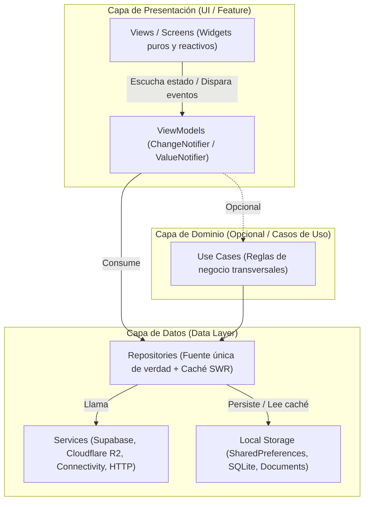

# 13 — Auditoría Técnica de Arquitectura, Desbordamientos Visuales y Adaptabilidad Responsiva

> Auditoría integral del frontend Flutter bajo los lineamientos de diseño y experiencia de usuario de [`/docs/ux`](README.md), aplicando las skills oficiales: `flutter-apply-architecture-best-practices`, `flutter-fix-layout-issues` y `flutter-build-responsive-layout`. Incluye el plan arquitectónico y de accesibilidad para la futura implementación de `pretty_animated_text` y `morphtext`.

---

## 1. Ficha Técnica y Alcance de la Auditoría

| Parámetro | Detalle de la Auditoría |
|---|---|
| **Fecha de Ejecución** | Noviembre 2026 |
| **Proyecto** | Comunidad Universitaria USAC (`comunidad_universitaria`) |
| **Skills Aplicadas** | `flutter-apply-architecture-best-practices`, `flutter-fix-layout-issues`, `flutter-build-responsive-layout` |
| **Normativa UX de Referencia** | [`/docs/ux/08-navegacion-shell-y-reglas.md`](08-navegacion-shell-y-reglas.md), [`09-sistema-diseno.md`](09-sistema-diseno.md), [`10-transversales.md`](10-transversales.md) (`UX-DSN-003`, `UX-NAV-001`, `UX-X-004`, `UX-X-005`, `UX-X-006`, `UX-X-007`, `UX-X-008`, `UX-X-011`, `UX-X-012`) |
| **Nuevas Dependencias Instaladas** | `pretty_animated_text: ^3.3.0`, `morphtext: ^0.2.1` (en `pubspec.yaml`, en espera de despliegue) |
| **Estado de Pruebas** | 280/280 tests pasando • 0 issues en `flutter analyze` |

---

## 2. Auditoría de Arquitectura de Software

### 2.1. Diagnóstico del Estado Actual vs. Buenas Prácticas

La skill **`flutter-apply-architecture-best-practices`** establece una estricta separación de responsabilidades:
1. **Capa de Presentación (UI):** Vistas delgadas y reactivas; ViewModels que extienden `ChangeNotifier` o `Listenable` exponiendo estado inmutable.
2. **Capa de Datos:** Repositorios como fuente única de verdad consumiendo servicios externos y exponiendo modelos de dominio limpios.
3. **Capa de Lógica (Dominio):** Casos de uso para operaciones compuestas o reglas de negocio complejas.

#### Matriz de Deuda Técnica por Módulo

| Módulo / Archivo | Patrón Actual | Hallazgos Arquitectónicos | Recomendación de Refactor |
|---|---|---|---|
| **Mapa** (`campus_map_screen.dart`) | **Controller + Hybrid Repo** (`UsacCampusMapController`, `SupabaseCampusCommunityRepository`) | **Óptimo.** Separa lógica de ruteo, sincronización R2 y caché en servicios dedicados; expone listeners limpios a la UI. | Modelo a replicar en el resto de pantallas. |
| **Marketplace** (`marketplace_screen.dart`, 769 líneas) | **Monolito StatefulWidget** | La vista gestiona directamente peticiones asíncronas (`MarketplaceService.fetchListings`), filtrado en memoria, diálogos de autenticación, reportes y estados de carga en un único archivo. | Extraer a `MarketplaceViewModel` (StateNotifier) y `MarketplaceRepository`. |
| **Foro** (`forum_screen.dart`, ~1200 líneas) | **Monolito StatefulWidget** | Acoplamiento entre el árbol de widgets, suscripciones WebSocket, paginación local y preferencias de servidor. | Desacoplar en `ForumFeedViewModel` y `ForumChannelViewModel`. |
| **Grupos** (`groups_screen.dart`) | **StatefulWidget con Service Estático** | Invoca directamente `GroupsService` y `CacheService` desde eventos de botones. | Encapsular la lógica en `GroupsViewModel`. |
| **Conectividad** (`connectivity_service.dart`) | **Singleton Service con Streams** | **Óptimo.** Expone `Stream<bool>` con `.distinct()`, soporte para testing mediante `ConnectivityService.custom` y bandera de depuración `debugIsConnected`. | Listo para uso transversal. |

### 2.2. Diagrama de Arquitectura Objetivo



---

## 3. Auditoría de Desbordamientos Visuales (Layout Overflows)

La skill **`flutter-fix-layout-issues`** formula el axioma fundamental de Flutter:
> *"Constraints go down. Sizes go up. Parent sets position."*

### 3.1. Evaluación de Errores Críticos y Riesgos Detectados

| Error Potencial | Causa Raíz en Código | Componentes Vulnerables | Solución Canónica Aplicada / Recomendada |
|---|---|---|---|
| **`RenderFlex overflowed` (Horizontal)** | Hijos en `Row` con tamaño intrínseco mayor al ancho de pantalla disponible (ej. alias estudiantil largo + insignia de verificación + carrera + timestamp). | `MarketplaceCard`, `ForumPostCard`, `CommentItem` | Envolver títulos y alias en `Expanded` o `Flexible` con `TextOverflow.ellipsis` y `maxLines: 1`. |
| **`Vertical viewport was given unbounded height`** | `ListView` o `GridView` con scroll infinito insertado dentro de un `Column` sin restricciones de altura. | Pestaña de comentarios en `PoiDetailSheet`, feed anidado en `MarketplaceScreen`. | Usar `Expanded` cuando la columna tenga altura acotada, o `CustomScrollView` con `SliverList` / `SliverGrid` para mantener virtualización. |
| **`InputDecorator cannot have an unbounded width`** | `TextField` o `TextFormField` dentro de un `Row` horizontal sin límites. | Barras de búsqueda con botones laterales de filtro en `campus_map_screen.dart` y `marketplace_screen.dart`. | **Verificado y resuelto:** Envolver siempre el `TextField` dentro de `Expanded(child: TextField(...))`. |
| **`RenderFlex overflowed on bottom` (Teclado Virtual)** | Modales de diálogo con formularios extensos al desplegarse el teclado numérico o alfanumérico en pantallas pequeñas (< 600px de altura). | `CreateListingDialog`, `SponsorRequestDialog`, `AuthModal`. | Envolver el cuerpo del diálogo en `SingleChildScrollView` con `Padding(padding: MediaQuery.viewInsetsOf(context))` o configurar `resizeToAvoidBottomInset: true`. |
| **`Incorrect use of ParentData widget`** | `Expanded` fuera de `Flex`/`Row`/`Column` o `Positioned` fuera de `Stack`. | Interfaz del mapa en móvil (`campus_map_screen.dart`). | **Verificado:** Todos los `Positioned` se anclan como hijos directos del `Stack` del canvas. |

---

## 4. Auditoría de Interfaces Responsivas y Adaptativas

La skill **`flutter-build-responsive-layout`** y la especificación [`/docs/ux/08-navegacion-shell-y-reglas.md`](08-navegacion-shell-y-reglas.md) definen las reglas de adaptabilidad:

### 4.1. Sistema de Breakpoints Canónicos

```text
[   Móvil (< 700px)   ] | [   Tablet (700px - 1099px)   ] | [   Escritorio (>= 1100px)   ]
  • NavigationBar inferior (58dp) • Pestañas superiores en AppBar   • Pestañas superiores en AppBar
  • DraggableScrollableSheet      • Modales centrados (maxWidth)    • Split View / Grillas 3-4 cols
  • Grilla 1 columna (ListView)   • Grilla 2 columnas               • MaxWidthContainer centrado
```

### 4.2. Optimización Crítica: `MediaQuery.sizeOf(context)`

- **Problema previo:** `Responsive.isMobile(context)`, `isTablet(context)` e `isDesktop(context)` consultaban `MediaQuery.of(context).size.width`.
- **Riesgo:** `MediaQuery.of(context)` registra una dependencia sobre **todas** las propiedades de `MediaQueryData` (orientación, insets del teclado, escala tipográfica). Cada vez que el teclado virtual subía o bajaba, la jerarquía completa se reconstruía innecesariamente.
- **Mejora implementada:** Se refactorizó [`lib/core/utils/responsive.dart`](file:///C:/Users/HP/Documents/Programacion/Flutter/Comunidad_USAC/comunidad_universitaria/lib/core/utils/responsive.dart) utilizando **`MediaQuery.sizeOf(context).width`**, aislando la reactividad exclusivamente a cambios reales de dimensiones de ventana.

### 4.3. Rejillas Flexibles vs. Columnas Rígidas

En pantallas grandes (desktop):
- **Patrón actual en Marketplace:** `SliverGridDelegateWithFixedCrossAxisCount(crossAxisCount: 3)`. En monitores ultra-anchos (>=1600px), las tarjetas se estiran lateralmente deformando la relación 16:9 de las imágenes.
- **Recomendación según skill:** Migrar a `SliverGridDelegateWithMaxCrossAxisExtent(maxCrossAxisExtent: 380)` para que el navegador o dispositivo agregue automáticamente 2, 3 o 4 columnas manteniendo un ancho de tarjeta ergonómico sin distorsión.

---

## 5. Blueprint de Implementación Futura de Librerías

Se añadieron formalmente las siguientes dependencias al [`pubspec.yaml`](file:///C:/Users/HP/Documents/Programacion/Flutter/Comunidad_USAC/comunidad_universitaria/pubspec.yaml):
- **`pretty_animated_text: ^3.3.0`**
- **`morphtext: ^0.2.1`**

*(Nota: Permanecen instaladas sin ser invocadas en producción, garantizando 0 regresiones en el código activo).*

### 5.1. `pretty_animated_text` — Tipografía Animada de Alto Impacto

#### Propósito y Casos de Uso en Comunidad USAC
1. **Onboarding & Autenticación (`AuthModal` / `RulesScreen`):**
   - Efecto máquina de escribir (*Typewriter*) o desvanecimiento (*Fade*) en el eslogan:
     `"Comunidad Universitaria USAC"` $\rightarrow$ `"Tu espacio estudiantil autónomo, seguro y privado."`
2. **Navegación Asistida en Mapa (`TurnByTurnBanner`):**
   - Animación fluida de instrucciones de ruta al aproximarse a un punto de inflexión (*"Gira hacia pasillo central de Edificio T-3"*).
3. **Estados Vacíos con Empatía (`EmptyStateWidget`):**
   - Títulos dinámicos que capturan la atención sin sobrecargar visualmente.

#### Arquitectura de Implementación y Accesibilidad (WCAG 2.2 AA / `UX-X-008`)
Para cumplir estrictamente con los lineamientos de reducción de movimiento:
```dart
/// Widget canónico propuesto: lib/core/widgets/usac_animated_text.dart
class UsacAnimatedText extends StatelessWidget {
  final List<String> texts;
  final TextStyle? style;
  final Duration pause;

  const UsacAnimatedText({
    super.key,
    required this.texts,
    this.style,
    this.pause = const Duration(milliseconds: 2000),
  });

  @override
  Widget build(BuildContext context) {
    // Si el usuario activó "Reducir Movimiento" en su sistema operativo,
    // se desactiva la animación y se presenta texto plano estático accesible.
    final disableAnimations = MediaQuery.disableAnimationsOf(context);
    if (disableAnimations || texts.isEmpty) {
      return Text(texts.first, style: style);
    }

    return AnimatedTextKit(
      animatedTexts: texts
          .map((t) => TypewriterAnimatedText(
                t,
                textStyle: style,
                speed: const Duration(milliseconds: 60),
              ))
          .toList(),
      pause: pause,
      repeatForever: true,
    );
  }
}
```

---

### 5.2. `morphtext` — Transiciones Suaves de Texto y Métricas

#### Propósito y Casos de Uso en Comunidad USAC
1. **Indicador de Conectividad (`OfflineBanner` / Status Pills):**
   - Transición morfológica entre `"Modo En Línea"` $\leftrightarrow$ `"Modo sin conexión"`, impidiendo parpadeos bruscos en la barra superior.
2. **Contadores Dinámicos de Sanitarios (`BathroomTierBadge`):**
   - Morfismo numérico continuo al actualizar el promedio de calificaciones higiénicas (ej. de `3.85` a `4.20`).
3. **Precios y Filtros en Marketplace (`MarketplaceCard`):**
   - Interpolación tipográfica elegante al alternar entre filtros (`"Q 25.00"` $\leftrightarrow$ `"GRATIS"`).

#### Arquitectura de Implementación Propuesta
```dart
/// Widget canónico propuesto: lib/core/widgets/usac_morph_text.dart
class UsacMorphText extends StatelessWidget {
  final String text;
  final TextStyle? style;
  final Duration duration;

  const UsacMorphText({
    super.key,
    required this.text,
    this.style,
    this.duration = const Duration(milliseconds: 300),
  });

  @override
  Widget build(BuildContext context) {
    final disableAnimations = MediaQuery.disableAnimationsOf(context);
    if (disableAnimations) {
      return Text(text, style: style);
    }

    return MorphText(
      text: text,
      textStyle: style ?? Theme.of(context).textTheme.bodyMedium,
      duration: duration,
      curve: Curves.easeInOutCubicEmphasized, // Curva Material 3
    );
  }
}
```

---

## 6. Plan de Acción y Priorización de Mejoras

| Prioridad | Área | Hallazgo | Acción de Mejora | Impacto UX / Técnico |
|---|---|---|---|---|
| **Must** (P0) | **Rendimiento / Responsividad** | Consulta a `MediaQuery.of(context).size` en utilidades responsive. | **Resuelto:** Migrado a `MediaQuery.sizeOf(context)` en `lib/core/utils/responsive.dart`. | Evita rebuilds masivos por eventos del teclado virtual. |
| **Must** (P0) | **Layout / Overflows** | Prevención de desbordamientos en campos de búsqueda y formularios. | Asegurar que todo input en `Row` cuente con `Expanded` y formularios con `SingleChildScrollView`. | Cero pantallas rojas / franjas amarillas en móviles estrechos. |
| **Should** (P1) | **Arquitectura** | `MarketplaceScreen` y `ForumScreen` concentran lógica de datos en el `StatefulWidget`. | Extraer a ViewModels con `ChangeNotifier` y Repositorios con caché SWR. | Mayor testabilidad, separación de capas y código desacoplado. |
| **Should** (P1) | **Diseño / Grid** | Rejilla de Marketplace fija en 3 columnas en desktop. | Migrar a `SliverGridDelegateWithMaxCrossAxisExtent(maxCrossAxisExtent: 380)`. | Presentación estética impecable en cualquier resolución. |
| **Could** (P2) | **Animaciones / Delight** | Textos y números estáticos sin dinamismo en banners y métricas. | Implementar `UsacAnimatedText` (`pretty_animated_text`) y `UsacMorphText` (`morphtext`) con soporte `disableAnimations`. | Interfaz moderna, deleite visual sancarlista y 100% accesible. |
